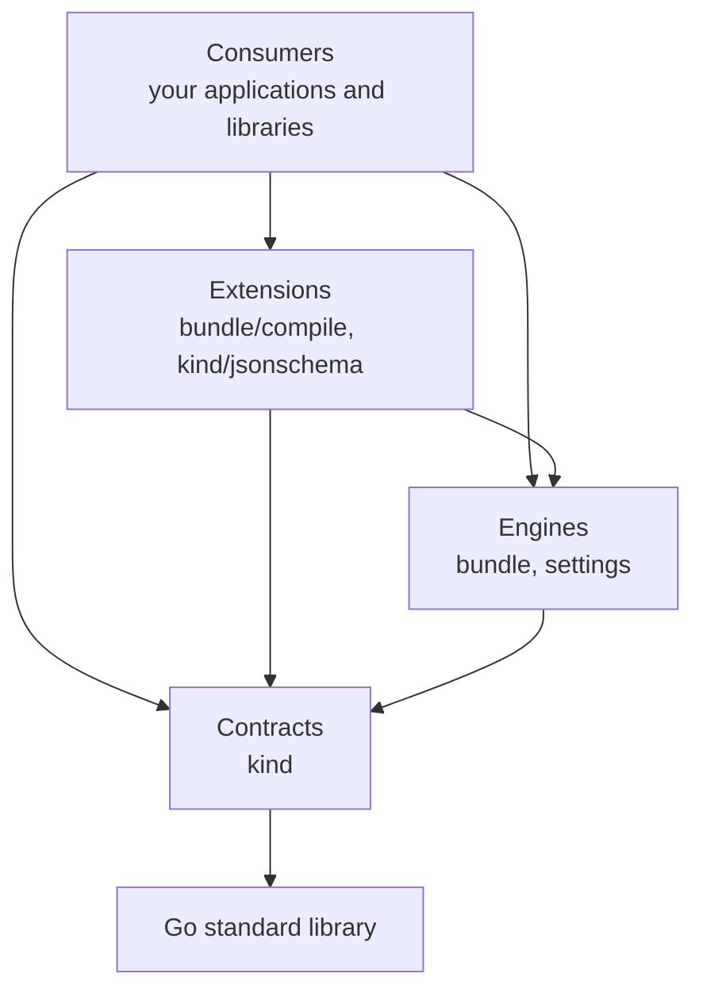

# Foundation Kit

Foundation Kit is a set of Go packages for building applications and libraries on shared foundations. It's for the things every application otherwise writes for itself, starting with loading authored content such as scripts, prompts and schemas.

> **Status: early development.** The packages work, but nothing is released yet and the API will change until there is. No consumer has been migrated to `bundle` yet. See [Packages](#packages) for what works today.

## The problem it solves

Applications tend to grow a separate loader for each type of content, each with its own file layout, parser, naming rule and error format. `cclab-platform`, for example, [reaches 55 files through seven unrelated mechanisms](docs/research/claude.md.md#L31).

Foundation Kit replaces that with one pipeline. You declare a kind of content and how to read it, and the kit handles path safety, identity, digests, linking and error reporting:

```go
// Declare a kind next to the type it produces.
var Profile = kind.New[ProfileSpec]("example.profile", 1)

// Load bundles from disk and built-in definitions from Go code into one catalog.
catalog, err := bundle.Load(ctx, bundle.Options{
	Sources:   []bundle.Source{bundle.Dir("res/profiles")},
	Compilers: []bundle.AnyCompiler{bundle.Compile(Profile, compile.JSON[ProfileSpec]())},
	Providers: []kind.Provider{{
		ID:       "example.builtins",
		Version:  "1.0.0",
		Builtins: []kind.AnyBuiltin{kind.Builtin(Profile, "default", ProfileSpec{Retries: 3})},
	}},
})
if err != nil {
	return err // lists every problem at once, not just the first
}

// Read definitions back with their Go type, and no casting.
for _, def := range bundle.All(catalog, Profile) {
	fmt.Println(def.Ref, def.Value.Retries)
}
```

A bundle is a directory with a `bundle.yaml` at its root:

```text
profiles/
├── bundle.yaml
└── fast.json
```

```yaml
apiVersion: craggy.io/bundle/v1

metadata:
  id: example.profiles
  version: 0.1.0

contributions:
  - id: fast
    kind: example.profile@1
    path: fast.json
```

## Layers

The kit is organised in layers, and imports only ever point down. This is what lets it keep growing: a library can use a low layer without inheriting everything above it.



| Layer | What belongs there | Dependencies |
| --- | --- | --- |
| **Contracts** | Types and interfaces that libraries can depend on cheaply. No I/O. | Standard library only |
| **Engines** | Generic mechanisms that do the real work, such as the bundle pipeline. | Contracts, plus small dependencies hidden in `internal/` |
| **Extensions** | Optional additions to an engine or contract, such as ready-made compilers. | Contracts and engines. May add their own dependencies. |
| **Test support** | Helpers for testing against the kit, such as `bundletest`. Sits alongside the layers. | Anything, but only tests may import it |

Nothing in the kit knows about any product. If a package needs a word like "lab" or "APK", it belongs in the library or application that owns that concept.

## Packages

| Package | Layer | Purpose | Status |
| --- | --- | --- | --- |
| [`kind`](kind/README.md) | Contracts | Versioned types of definition, with optional schemas and built-ins | Working |
| [`bundle`](bundle/README.md) | Engines | Loads bundles and built-ins into one catalog | Working, not yet used by a consumer |
| `bundle/compile` | Extensions | Ready-made compilers for text, JSON and YAML | Working |
| `kind/jsonschema` | Extensions | JSON Schema support for kinds | Working |
| [`settings`](settings/README.md) | Engines | Live, user-editable values, declared by the code that reads them | Working |
| `bundle/bundletest` | Test support | Helpers for testing kinds, compilers and bundles | Working |
| [`archtest`](archtest/README.md) | Test support | Turns architecture rules into test failures | Working |

We also expect to add packages for lifecycle management, logging and an HTTP server. None of them exist yet, and each will be added once real applications need it.

## Using it

The kit requires Go 1.25 or later, and its module path is `github.com/craggy-io/foundation-kit`. There's no tagged release yet, and the API will change until there is.

To develop the kit alongside an application, use an uncommitted `go.work` file rather than a `replace` directive in `go.mod`.

## Contributing

```sh
go build ./... && go vet ./... && go test ./...
```

Before adding a package, check the rules for [what belongs in the kit](AGENTS.md#does-it-belong-here). They apply to people as well as coding agents.

## Documentation

| Document | What it's for |
| --- | --- |
| [AGENTS.md](AGENTS.md) | Rules for working in this repository, and for building on it |
| [docs/decisions](docs/decisions) | Decisions we've made, starting with the [standard vocabulary](docs/decisions/ADR-0001-standard-vocabulary.md) |
| [docs/research](docs/research) | Background research. It informed the decisions but isn't binding, and its proposals conflict with each other. |
