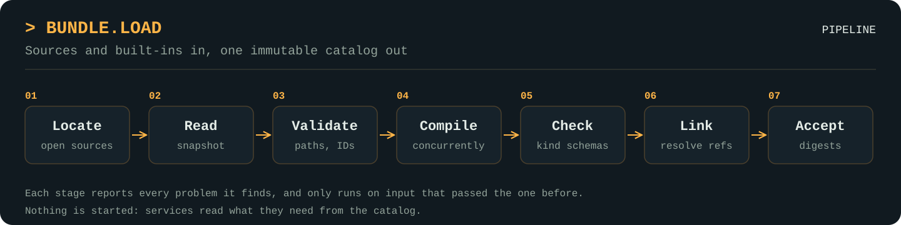

# bundle

`bundle` loads definitions and assets, such as scripts, prompts and schemas, from directories that describe themselves with a `bundle.yaml` file, and combines them with built-in definitions from Go code into one catalog. It replaces a separate loader for each kind of content with one pipeline: you say how a kind is read, and `Load` handles path safety, identity, digests, linking and error reporting.

```go
import "github.com/craggy-io/foundation-kit/bundle"
```

> **Status: working, unreleased.** The whole pipeline, bundle-level overrides, global kinds and `Live` reloading and installs are implemented and tested. Consumers are being migrated now, so the API may still change. See [Implementation status](#implementation-status).

Kinds are declared in the [`kind`](../kind/README.md) package. Terms used here are defined in [ADR-0001](../docs/decisions/ADR-0001-standard-vocabulary.md), and bundle overrides, global kinds, dependency files and `Live` are decided in [ADR-0002](../docs/decisions/ADR-0002-live-catalogs-and-layering.md).

## Bundle layout

A bundle is a directory with exactly one `bundle.yaml`, at its root. **Every bundle needs a real `bundle.yaml` on disk** (or in its embedded file system): a folder without one isn't a bundle, and nothing in the kit generates a manifest from a folder layout or file names, including `Live.Install`. `Live.Edit` writes one only from the contributions its caller names. Assets go in an `assets/` directory at the root. Everything else is laid out however suits the author, because the manifest gives each contribution's path.

```text
android-research/
├── bundle.yaml
├── assets/
│   ├── models/
│   │   └── classifier.bin
│   └── prompts/
│       └── review.md
├── scripts/
│   └── gate-audit.star
├── agents/
│   ├── team.star
│   └── helpers.star
└── schemas/
    └── reviewer-output.json
```

## bundle.yaml

```yaml
apiVersion: craggy.io/bundle/v1

metadata:
  id: example.android-research   # required: the bundle's identity
  version: 0.1.0                 # required: the author's release label
  title: Android research        # optional

dependencies:                    # optional: bundles this one may reference
  - id: example.shared-prompts
    digest: sha256:...           # optional: pin to exact content

contributions:                   # the entries in this bundle
  - id: audit                    # required: unique within the bundle
    kind: example.script@1       # required: selects the compiler
    path: scripts/gate-audit.star  # required: relative to this file

  - id: research-team
    kind: example.agent-team@1
    path: agents/team.star
    assets:                      # optional: files this contribution uses from assets/
      - assets/prompts/review.md
      - assets/models/classifier.bin
```

Bundle, dependency, provider, built-in and contribution IDs use letters, digits, `.`, `_` and `-`, and start and end with a letter or digit. String fields must be YAML strings, so quote a value such as `version: "1.0"` that YAML would read as a number.

A definition is referred to as `owner-id#id`, where the owner is its bundle or provider, for example `example.android-research#audit`.

## Assets and support files

A bundle has two sorts of file besides its manifest and contributions, and both count towards the bundle's digest:

| | Asset | Support file |
| --- | --- | --- |
| **Where it lives** | Under `assets/` at the bundle root | Anywhere else |
| **Declared in `bundle.yaml`** | Yes, under the contributions that use it | No |
| **Held in memory after `Load`** | No, only its path, size and digest | Yes, in the snapshot |
| **Read by** | Compilers and consumers, through `Asset` | Compilers, through `Contribution.Files` |
| **Example** | A prompt or model a service uses at runtime | A helper module a script loads at compile time |

`Load` reads each asset once to hash it, without holding its bytes. Every definition then lists its contribution's assets, and reading them is up to you:

```go
def, ok := bundle.Get(catalog, Team, ref)
if !ok {
	return fmt.Errorf("no definition %s", ref)
}

// Read a small asset whole. No bytes are returned unless they all match the digest.
prompt, ok := def.Asset("assets/prompts/review.md")
if !ok {
	return errors.New("no review prompt")
}
data, err := prompt.Read(ctx)

// Stream a large one. Its content is only verified when the stream reaches EOF.
model, ok := def.Asset("assets/models/classifier.bin")
if !ok {
	return errors.New("no classifier")
}
r, err := model.Open(ctx)
```

A contribution's assets are also in `Contribution.Assets`, for a compiler whose result depends on their bytes.

Because the bytes stay in the `Source`, reading an asset can fail after `Load` has succeeded:

- **Changed content:** the read returns `ErrAssetChanged`, because the bytes no longer match the digest in the catalog.
- **Removed file:** the read returns an error matching `fs.ErrNotExist`.

A `Source` must therefore keep working for as long as its catalog is in use. An `Embedded` source can't change, so it's the safest choice for assets that must always be readable.

## Rules

`Load` enforces these for every kind:

- **Identity comes from the manifest.** Renaming a folder changes nothing.
- **There is one manifest per bundle.** A `bundle.yaml` anywhere other than the root is an error.
- **The YAML is strict.** Duplicate keys, aliases, merge keys, custom tags and unknown fields are errors.
- **Paths stay inside the bundle.** Escaping paths and symlinks are errors.
- **Assets stay in `assets/`.** A listed asset must be a file under `assets/`, and a contribution's `path` must be outside it.
- **Assets are declared.** A listed asset that doesn't exist is an error, and so is a file under `assets/` that no contribution lists. Contributions can share an asset.
- **Malformed kinds and kinds with no compiler are errors.** To disable a feature, leave its bundles out of `Options.Sources`.
- **Schemas apply to every definition.** If a kind has a schema, it checks compiled values and built-ins alike.
- **Duplicates are errors.** Order never picks a winner, and replacing something requires an explicit `Override` or `BundleOverride`.
- **Global kinds have unique names.** For a kind declared with `kind.Global()`, two effective definitions with the same contribution ID in different bundles or providers are an error (`bundle.id_conflict`). Settle it with an override, or rename one.
- **References are declared.** A reference into another bundle must be listed in `dependencies`, and so must a bundle whose files a compiler reads through `Contribution.Dependency`.
- **Every problem is reported at once.** Reports are deterministic, and a failed load returns no catalog. A bundle that fails validation isn't compiled, but the other bundles still are, so one load reports as much as it can.
- **Bundles are bounded.** A bundle may hold at most 10,000 files, and its files outside `assets/` at most 16 MiB each and 256 MiB together (`bundle.limit_exceeded`). Assets have no size limit.
- **Overrides take one step.** An override's target and replacement must exist and have the same kind, a target can be overridden only once, and a replacement can't itself be overridden. `Get` on the target returns the replacement's value, owner and assets, `All` lists only the replacement, and `Catalog.Explain` and `Catalog.Overrides` show the replacement.
- **Bundle overrides chain.** An owner can be the target of one `BundleOverride`, which may itself be overridden, so layers such as project over user over shipped work. Each chain is flattened into one-step overrides. Unknown owners, self-overrides, an owner targeted twice and cycles are `bundle.override_invalid`.
- **Loading has no side effects.** Listing a definition must not start or contact anything.

## Usage

Declare each kind once, in the library or application that owns it, then give `Load` everything the application uses:

```go
var Profile = kind.New[ProfileSpec]("example.profile", 1)

catalog, err := bundle.Load(ctx, bundle.Options{
	// Definitions from bundles: each Source is one bundle.
	Sources: []bundle.Source{
		bundle.Embedded("defaults", defaultsFS), // root contains bundle.yaml
		bundle.Dir("res/android-research"),      // so does this directory
	},
	Compilers: []bundle.AnyCompiler{
		bundle.Compile(Profile, compile.JSON[ProfileSpec]()),
	},

	// Definitions from Go code join the same catalog.
	Providers: []kind.Provider{{
		ID:       "example.builtins",
		Version:  "1.0.0",
		Builtins: []kind.AnyBuiltin{kind.Builtin(Profile, "default", ProfileSpec{Retries: 3})},
	}},
})
if err != nil {
	return err // a *bundle.LoadError listing every problem
}

for _, def := range bundle.All(catalog, Profile) {
	fmt.Println(def.Ref, def.Value.Retries) // def.Value is a ProfileSpec
}
```

Sources are listed explicitly because `Load` doesn't scan directories for bundles. To list a folder that holds one bundle per subfolder, such as an install folder, use `Children`:

```go
installed, err := bundle.Children(ctx, "/home/me/.app/bundles")
```

It returns a `Dir` source for each immediate subfolder with a `bundle.yaml`, sorted by name. A missing folder gives no sources and no error. Subfolders with no `bundle.yaml`, subfolders whose names start with `.`, files and symlinks are skipped without an error, so a host that wants a folder without a manifest to be an error must check for it itself.

### Layering bundles

A `BundleOverride` layers one owner over another. Every contribution ID they share behaves like an `Override`, and IDs only the replacement has are added:

```go
bundle.Options{
	Sources: sources,
	BundleOverrides: []bundle.BundleOverride{
		{Target: "app.shipped", Replacement: "app.user"},
		{Target: "app.user", Replacement: "app.project"},
	},
}
```

Each contribution then resolves to the highest layer that has its ID. Report what was shadowed with `Catalog.Overrides`, which lists every applied replacement sorted by target.

### Looking up by name

Some kinds are named by contribution ID alone, across bundles, such as agents or profiles. Declare them global, then use `Lookup`:

```go
var Agent = kind.New[AgentSpec]("example.agent", 1, kind.Global())

def, ok := bundle.Lookup(catalog, Agent, "reviewer") // whichever owner defines it
```

`Load` guarantees at most one effective definition per ID, and `Lookup` reports false for a kind that isn't global.

### Reading a dependency's files

A compiler can read the snapshot of any bundle its manifest declares in `dependencies`, for example so that a Starlark `load()` can reach a shared library bundle:

```go
files, lib, ok := c.Dependency("example.shared-lib")
src, err := fs.ReadFile(files, "lib/strings.star")
```

Undeclared bundles and providers aren't visible. The dependency's digest is part of the key `Live` uses to reuse compiled values, so changing a library recompiles everything that depends on it.

### Reloading and installing with Live

`Live` holds the current catalog of a running host. Every change runs `Load` again with the same rules, and the new catalog replaces the old one whole, or not at all:

```go
live, err := bundle.NewLive(ctx, func(ctx context.Context) (bundle.Options, error) {
	installed, err := bundle.Children(ctx, installDir) // listed again on every load
	if err != nil {
		return bundle.Options{}, err
	}
	return bundle.Options{Sources: append(shipped, installed...), Compilers: compilers}, nil
})
if err != nil {
	return err // the first load must succeed
}

unsubscribe := live.Subscribe(func(old, new *bundle.Catalog) { /* restart what changed */ })
defer unsubscribe()

go live.Run(ctx, 2*time.Second, func(err error) { log.Print(err) }) // poll for edits

// Install files that include their own bundle.yaml into installDir/<metadata.id>.
id, err := live.Install(ctx, installDir, files)

// Add or replace one contribution, and remove another, in installDir/user,
// starting that bundle if it doesn't exist.
_, err = live.Edit(ctx, installDir, "user",
	[]bundle.Put{{ID: "helper", Kind: agentKind.ID(), Path: "agents/helper.star", Data: src}},
	[]string{"old-helper"})

// Remove it again. This fails, and changes nothing, if another bundle depends on it.
err = live.Uninstall(ctx, installDir, id.ID)
```

- **`Catalog`** never blocks. Each call returns an immutable catalog, so read everything one task needs from a single one.
- **`Reload`** reruns the options function and `Load`. It swaps the catalog and notifies subscribers only if the digest or an owner's identity changed. On failure it keeps the last good catalog and returns the `*LoadError`.
- **`Run`** calls `Reload` every interval until `ctx` is cancelled, sending errors to a callback rather than stopping.
- **`Install`** stages the files in a hidden folder under the install folder, moves any existing `dir/<metadata.id>` aside, moves the new bundle into place, and reloads. If that load fails, it puts everything back and returns the `*LoadError`. The options function must list the install folder, for example with `Children`.
- **`Uninstall`** moves `dir/<id>` aside and reloads, putting it back if the load fails.
- **`Edit`** is explicit editing, not manifest generation: the caller names each contribution's ID, kind and path. It reads `dir/<id>`, or starts a bundle with version `1.0.0`, sets each `Put` and drops each removed ID with its file, rewrites `bundle.yaml` (keeping metadata, dependencies and assets, but not comments), and installs the result through `Install`, or `Uninstall` when nothing is left.
- **Compile reuse:** a reload calls a compiler only if the contribution's bundle digest, origin, declared dependencies' digests or kind changed. Reused values are still checked against their kind's schema.
- **Concurrency:** changes are serialized. The options function and subscribers run during a change, so they must not call `Reload`, `Install`, `Uninstall` or `Edit`.

## Ready-made compilers

Most kinds just read one file into a value, so the `compile` package covers them. A kind with extra rules can wrap one of these or write its own `Compiler`.

| Compiler | Value |
| --- | --- |
| `compile.Text()` | The file's contents as a string |
| `compile.JSON[T]()` | The file decoded into `T`, rejecting unknown fields and trailing data |
| `compile.YAML[T]()` | The file decoded into `T` under the same strict rules as `bundle.yaml`, then with the same rules and `json` struct tags as `compile.JSON` |

## Pipeline

<p align="center">
  <a href="../docs/assets/bundle-pipeline.svg">
    
  </a>
</p>

| Stage | What happens | Code |
| --- | --- | --- |
| Locate | Open each selected source | `source.go` |
| Read | Snapshot the files, hash the assets and parse `bundle.yaml` | `internal/snapshot`, `internal/manifest` |
| Validate | Check the manifest, paths, assets, IDs, kinds and duplicates | `internal/manifest`, `pipeline.go` |
| Compile | Call each contribution's compiler, concurrently | `compiler.go`, `pipeline.go` |
| Check | Apply each kind's schema to compiled values and built-ins | `kind.Kind.Validate` |
| Link | Combine bundles and providers, expand bundle overrides, then resolve dependencies, references and overrides, and check global IDs | `internal/link` |
| Accept | Compute digests and publish the immutable catalog | `internal/digest`, `catalog.go` |

Nothing is started by `Load`. Services read what they need from the catalog and start it themselves.

## Package layout

| Path | Purpose |
| --- | --- |
| `load.go` | `Load`, `Options`, `Override`, `BundleOverride` |
| `pipeline.go` | The stages that `Load` runs |
| `compiler.go` | `Compile`, `AnyCompiler`, `Compiler[T]`, `Compiled[T]`, `Contribution` |
| `catalog.go` | `Catalog`, `Definition[T]`, `All`, `Get`, `Lookup` |
| `live.go` | `Live`, `NewLive`, reloading, `Install`, `Uninstall` and `Edit` |
| `asset.go` | `Asset`, `ErrAssetChanged` |
| `source.go` | `Source`, `Dir`, `Embedded`, `Children` |
| `reference.go` | `Ref`, `ParseRef`, `Identity` |
| `diagnostic.go` | `Diagnostic`, `LoadError`, severities and codes |
| `compile/` | Ready-made compilers |
| `bundletest/` | Helpers for testing kinds, compilers and shipped bundles |
| `internal/manifest/` | `bundle.yaml` decoding and validation, using the strict YAML subset in the module-root [`internal/strictyaml`](../internal/strictyaml), which is the only import of the YAML library (`go.yaml.in/yaml/v3`) |
| `internal/snapshot/` | Path policy, immutable file copies and asset hashing |
| `internal/digest/` | Canonical file, bundle and catalog hashing |
| `internal/link/` | Reference, dependency, override and bundle override resolution, and global ID checks |
| `testdata/` | Valid and deliberately invalid bundles, override layers, global ID conflicts, dependency reads and installs |

## Out of scope

- **Kind-specific logic:** compilers live with whatever owns the kind, and Starlark evaluation isn't part of this package.
- **Host-owned concerns:** secrets, capability grants and enablement stay outside bundles. A bundle must not be able to authorize itself.
- **Starting and supervising:** that belongs to the owning services.
- **Distribution:** remote fetching, archives, version solving and install hooks aren't included. Fetch and verify remote content first, then present it as a `Source`, or pass its files to `Live.Install`.
- **Watching files:** `Live` polls through `Run` or reloads when asked. It doesn't use file system notifications. Hot reload itself is in scope, through `Live`.
- **Generating manifests:** never. A folder needs its own `bundle.yaml`.
- **Sandboxing:** compilers run in-process, so loading is for trusted content only.

## Known limitations

- **Built-in identity:** a built-in has no file bytes, so its digest is empty. The catalog digest covers only its provider's ID and version, so changing a built-in's value without changing that version doesn't change the digest.
- **Built-in references:** a built-in can't declare references to other definitions.
- **`compile.JSON`:** it doesn't detect duplicate keys, and its diagnostics have no line numbers.
- **`compile.YAML` positions:** syntax and strictness problems have exact lines, but a decoding error such as an unknown field or a wrong type is placed by searching for the field's name, so it can point at the wrong line when that name appears more than once.
- **Limits:** the bundle size limits are fixed. Raise them in `pipeline.go` if a real bundle needs more, rather than adding an option speculatively.
- **Dependencies are all-or-nothing:** a declared dependency that isn't loaded is an error (`bundle.dependency_missing`), so there are no optional dependencies.
- **Asset load time:** `Load` hashes every asset on every load, so very large assets slow startup even though their bytes aren't kept.
- **Asset streaming:** bytes from `Asset.Open` are unverified until the stream reaches EOF.
- **Asset paths:** an asset is only reachable as a stream, so a tool that needs a real file path has to copy it to disk first.
- **Old assets after a reload:** a catalog doesn't keep its own copy of its assets. If a directory is updated in place, or replaced by `Live.Install`, reads through the old catalog fail with `ErrAssetChanged`.
- **Install isn't crash-safe:** `Install` and `Uninstall` validate the folder after moving it into place, so the host's options function sees it as it will be. A process that stops part-way can leave the new bundle in place and the previous one in a hidden `.install-*` folder, and another process can see the new folder while it's being validated.
- **Compile reuse trusts compilers:** a compiler's result must depend only on what its `Contribution` exposes. If a compiler changes its output for the same files, change the kind's version.
- **Polling cost:** each `Reload` snapshots and hashes every bundle, including assets, even when nothing changed. Only compiling is skipped.

## Implementation status

Working and tested:

- `Load`, with every stage above, and `Options`, `Override`, `BundleOverride` (chains, cycles, unknown owners)
- Global kinds through `kind.Global`, `bundle.id_conflict` and `Lookup`
- `Contribution.Dependency`
- `Live`: `NewLive`, `Catalog`, `Reload`, `Run`, `Subscribe`, `Install`, `Uninstall`, `Edit`, with compile reuse, tested under `-race`
- `Children`
- `Dir`, through `os.OpenRoot`, and `Embedded`
- `Catalog`, `Catalog.Digest`, `Catalog.Owners`, `Catalog.Explain`, `Catalog.Overrides`, `All` and `Get`
- `Asset`, including verified `Read` and `Open`
- `Compile`, `Ref`, `ParseRef`, `Identity`, `LoadError` and every diagnostic code
- `compile.Text`, `compile.JSON` and `compile.YAML`
- `bundletest.Load`, `bundletest.CheckSample` and `bundletest.RequireCode`
- `internal/manifest`, `internal/snapshot`, `internal/link`, and `internal/digest`, whose bundle and catalog encodings have golden tests
- Tests that load every `testdata` bundle, and examples of `Load`, `Dir` and `Live` with expected output

Still to build:

1. [ ] Port a real script kind and intel pack from `cclab-platform` before calling the API stable.

## Checks

```sh
go test ./...
go test -race ./bundle/...
```
