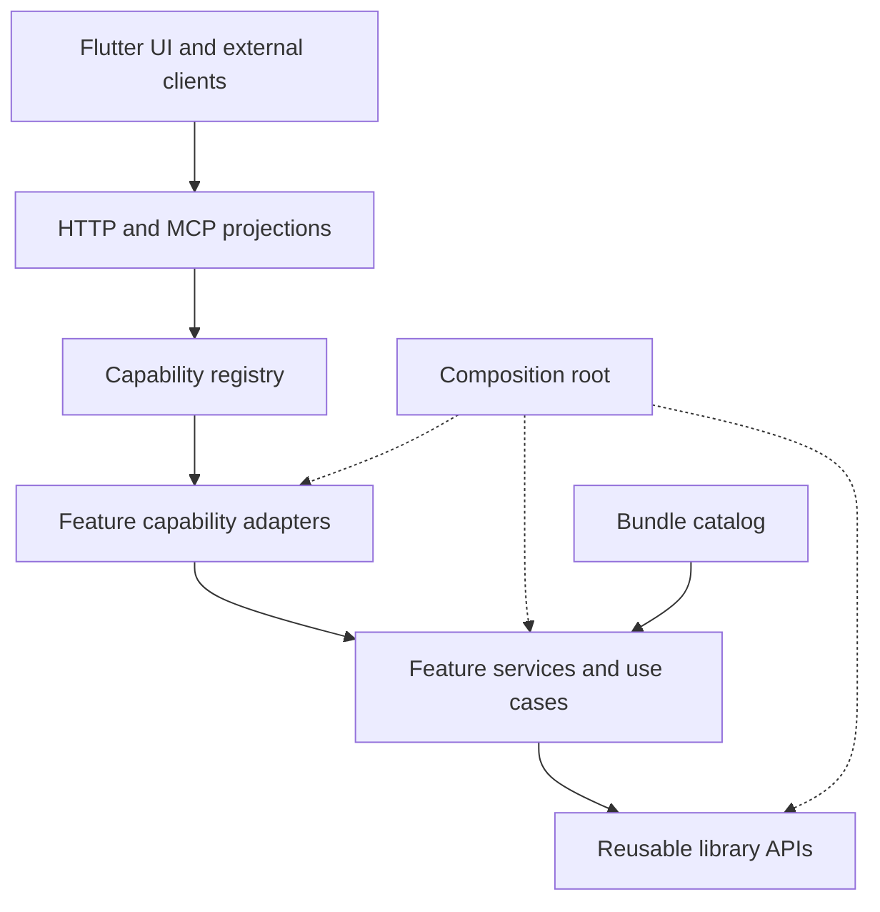
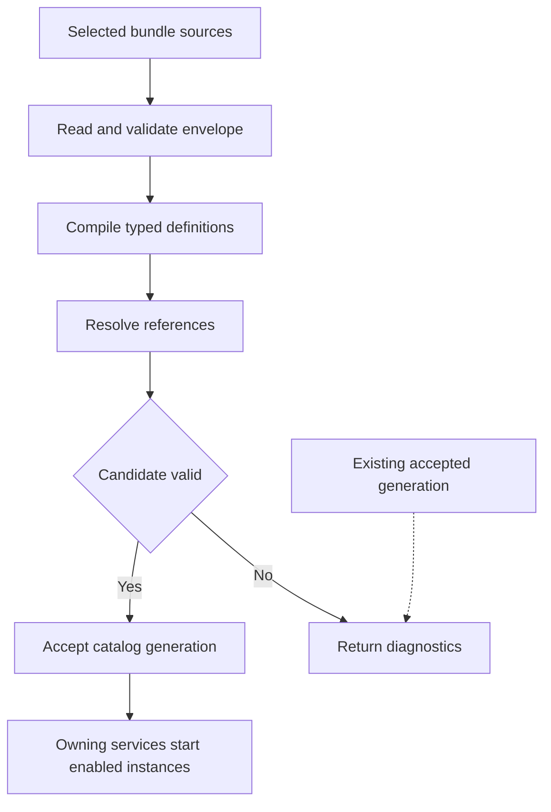

# Cleaner Architecture for CCLab Platform

**Research report and redesign proposal — 5 November 2026**

**Case study:** `philcantcode/cclab-platform`, default branch snapshot `86ba7fa87566673e54be09c65bb6bff921310e24`.

## Executive recommendation

Build a **modular application with a small composition layer, feature-owned services, and one shared bundle system for dynamic definitions and assets**. Continue using ordinary typed Go APIs inside the process. Retain the existing capability registry for HTTP, MCP, agent tools, and scripting boundaries.

Your intuition about consistent loading is supported by the code. There are separate conventions for agent definitions, workflows, intelligence packs, data sources, embedded gate resources, session settings, and promoted lab scripts. However, resource loading explains only part of the complexity. A large application package can still become difficult to change even when every resource uses the same manifest.

The recommended changes have three distinct purposes:

1. **Reduce the amount of code that can reach unrelated services.** Move feature adapters out of the shared `application` package, give each an explicit dependency struct, and make the composition root responsible only for wiring and lifecycle.
2. **Standardize how reusable content enters the application.** Adopt a versioned `bundle.yaml` convention, one identity and path-resolution policy, common diagnostics, and one staged loading pipeline. Typed handlers interpret different contribution kinds.
3. **Make reuse a supported product of the libraries.** Give every reusable repository a small documented public surface, familiar directory roles, executable examples, contract tests, and a build process that works outside your personal checkout layout.

The system should be understandable through three sentences:

- **Libraries implement reusable abilities.**
- **Features compose those abilities into application behavior.**
- **Bundles supply versioned definitions and assets to those features.**

The application assembles these pieces. A capability registry exposes their operations to boundary callers. Runtime runs, leases, evidence, and mutable settings remain owned by their respective services.

The important constraint is that the bundle system stays small. Its purpose is to remove repeated discovery, identity, validation orchestration, and source handling. It should not become a universal object model, workflow engine, dependency-injection container, or new replacement for your existing libraries.

## 1 The smallest comparison that could justify the design

Before investing in a general framework, compare two small changes against the same existing feature.

| Candidate | What changes | What it could improve | What would weaken the case |
| --- | --- | --- | --- |
| A — clearer ownership | Extract one feature's adapter and use cases from `application`; inject only its required services; retain its current loader | Smaller dependency surface, cheaper feature tests, less shared-package reach | Changes still require modifying unrelated assembly and resource code |
| B — clearer ownership plus shared bundles | Make the same extraction, then load that feature and a second resource kind through the common bundle path | Consistent identity, diagnostics, deployment, provenance, and adding resources | New kinds still need bespoke discovery/watch/override code, or the shared layer needs domain-specific branches |
| C — universal runtime plugins | Make every service and resource implement one generic plugin interface | Runtime installation of independently implemented functionality | Added lifecycle, version negotiation, casts, and indirection exceed the behavior actually required |

**Recommendation:** implement A and a bounded version of B. Keep C as a conditional future option.

Use two deliberately different resource kinds in the comparison: a Starlark script and an intelligence pack. They share identity, origin, compatibility, paths, and diagnostics, while their validation semantics differ. This is a stronger test than routing two nearly identical script dialects through the same helper.

Perform the same tasks in each candidate:

- Add a new resource of an already supported kind.
- Introduce a duplicate ID.
- Introduce a missing referenced file.
- Load from an embedded filesystem instead of a directory.
- Change a dependency and identify precisely which accepted definitions changed.
- Reject a malformed candidate without exposing half of its definitions.
- Add a third kind, such as an agent team, and record what common code must change.

Measure the files and packages touched outside the owner, the number of independent discovery mechanisms, the diagnostics produced, and the ability to test without assembling all of `App`. Do not use shorter source code as the sole success criterion: moving complexity into reflection or generic maps can reduce line counts while increasing conceptual load.

This report gives the full proposed architecture, but its additional mechanisms should earn their place through that comparison. The expected benefits are engineering hypotheses; they have not been benchmarked on a refactored implementation.

## 2 What the current repository shows

### Scope and confidence

The audit used a fixed platform commit rather than a moving branch. It inspected all 361 Go files under `src/`, the architecture instructions, resource files, the transport, selected Flutter integration files, and relevant accessible library repositories. Counts below are physical lines including comments and blanks; tests are files ending in `_test.go`. They indicate concentration, not defect rates.

This was a source and architecture review. Repository tests were not executed because the available executable named `go` was not a functioning Go toolchain. No runtime failure is inferred merely from file size.

The connected GitHub service returned 404 for `craggy-io/agent-sdk` and `craggy-io/data-services`. Their platform call sites and resource usage were inspectable, but their current internals were not. That response does not establish that those repositories do not exist. Recommendations involving new APIs in those libraries therefore require checking their actual supported interfaces.

### Measured concentration

| Area | Non-test Go files | Non-test lines | Test files | Test lines |
| --- | ---: | ---: | ---: | ---: |
| Entire `src/` tree | 197 | 47,919 | 164 | 30,549 |
| `src/core/application` | 56 | 15,204 | 93 | 18,612 |
| `src/internal/api` | 4 | 430 | 3 | 688 |

The application package contains approximately **31.7% of the non-test Go lines** and **60.9% of the Go test lines**. It defines 248 methods on `*App`; only four of those methods are exported. `App` has 37 fields, including 14 exported concrete service handles.

The important issue is therefore **package-wide access and concentration**, rather than hundreds of exported methods. Every method in the package can reach the same private fields and neighboring helper functions. Splitting a large file into additional files within that package does not narrow that access.

The package imports 30 other platform packages and 47 external non-standard-library package paths. These counts describe the direct imports of the package, not transitive dependencies. The existing five source import rules admit this arrangement; a static application of those rules found no matching source violations. They control where packages import, while the concentration occurs inside an allowed package. ([P1], [P2], [P3])

### The code already contains useful architectural decisions

Several existing choices should survive the redesign:

- **A single capability projection.** The application registers operations once and exposes the resulting registry through HTTP, MCP, tools, and Starlark. The transport is already comparatively small.
- **Direct Go calls inside the process.** The repository explicitly avoids routing ordinary internal service calls through the capability registry.
- **Consumer-owned ports and injected implementations.** The architecture instructions already require domain flows and rules to live outside assembly.
- **Shared execution plumbing.** `core/envjob` centralizes environment acquisition, transfer, heartbeat, and cleanup behavior that previously appeared in several features.
- **Separate authority from definitions.** Gate certification grants remain host-owned and tied to exact manifests.
- **Revisioned lab scripts.** Script editing, promotion, execution records, and provenance already have a model beyond loose files on disk.
- **Boundary tests.** Import rules and feature integration tests provide useful migration checks. ([P2], [P3], [P4], [P5], [P6])

This argues for an incremental redesign that strengthens ownership. A wholesale rewrite would replace working invariants at the same time as changing the boundaries intended to protect them.

### Why the current arrangement keeps accumulating complexity

The application instructions themselves recognize the attraction of `*App`: it can reach everything. They allow assembly, capability adapters, port implementations, middleware, and module-to-domain bridges in the same package. Each category is reasonable individually; their combination creates one shared integration namespace for nearly every feature. ([P2])

The structural problem is that **the easiest place to write new glue is also the place with the broadest authority**. A coding agent can satisfy an import rule while adding another method that depends on several unrelated services.

There are also several meanings of “module”: Go modules, analysis workers, Starlark imports, script definitions, and dynamically loaded content. “Core” currently includes application assembly, product concepts, reusable-looking utilities, and storage-backed services. Those names do not tell an agent which dependencies are legitimate.

The remedy is to make the intended owner and its allowed collaborators visible in the package API. Instructions remain useful, but code structure should make the routine choice easier than the exception.

### Resource loading is visibly inconsistent

| Resource family | Current mechanism at the platform boundary | Distinct behavior to preserve |
| --- | --- | --- |
| Agent definitions, skills, workflows | `agentsdef.DirRoots(resDir)`, followed by `Load()` | Agent inheritance, prompt references, skill/workflow relationships |
| Agent session configuration | Optional `agents-session.yaml` through `configyaml.Load` | Defaults and runtime setting overrides |
| Data sources | `dataservices.Open` with `SourceDirs`; optional separate `DataSourcesDir` | Collector status, source schedules, source-specific grants and revisions |
| Intelligence packs | `intel.Load(os.DirFS(...))` | Strict schemas, topic hierarchy, reference checks, contract compilation |
| Gate definitions and actors | Embedded library resources with host filesystem overrides | Exact definitions, qualification dependencies, actor assets |
| Security policies | Separate policy loader over gate resource views | Policy validation and host policy grants |
| Promoted scripts | Revisioned storage records projected through registry prefix replacement | Lab ownership, promotion, exact source revision, run history |

The common infrastructure is not yet a single contract. Missing data source definitions are treated differently from absent agent definitions, intelligence discovers `pack.yaml` directories and topic trees, and gates have an embedded fallback overlay. These differences are not all mistakes. The problem is that each subsystem independently expresses source selection and loading behavior, making the effective application configuration harder to inspect. ([P4], [P5], [P7], [P8], [P9])

One incidental resource path should not decide whether an installed feature is optional. Host configuration should declare required bundles and optional features explicitly.

### Configuration identity is another reason to unify loading

`captureConfiguration` records a hard-coded list of resource directories and only build dependencies under `github.com/philcantcode/cclab-`. The inspected list includes agents, skills, workflows, gates, intel, and the agent session YAML. It does not include the data source tree or the `DataSourcesDir` override, and the dependency filter does not include the new Craggy module paths. Hashing disk paths also cannot, by itself, describe the effective embedded-plus-override resource view. ([P10])

This is a concrete maintenance problem: every new loading convention requires another place to know how to identify it. A common loader should return the exact accepted resource inventory and digests, which performance reporting can consume directly. This finding concerns configuration provenance; it does not establish that gate certification's separate manifest checks are broken.

### The build workflow is part of the architecture

The inspected `go.mod` contains three local `replace` directives for `agent-sdk` and its adapters. The root instructions and `TestNoReplaceDirectives` prohibit committed replacements. The source therefore contains a directly observable policy inconsistency. The test body would report these lines if run; this report does not claim a test execution. ([P3], [P11])

This matters because an architecture spanning repositories needs a deliberate way to co-develop dependencies. Otherwise developers and agents choose between violating the release rules and repeatedly publishing intermediate changes.

## 3 What established designs teach us

The research points to specific mechanisms, not a single framework to copy.

| Source or system | Relevant mechanism | Application to CCLab |
| --- | --- | --- |
| Parnas on modular decomposition | Modules hide decisions likely to change; a dependency hierarchy is a separate property | Give each feature ownership of its rules and data meaning; make reusable layers independent of the product |
| Cockburn on ports and adapters | Application behavior can be driven through several adapters and tested independently of devices and databases | Keep meaningful use cases behind typed interfaces; HTTP, MCP, scripts, and tests should reach the same behavior |
| VS Code extensions | One manifest describes identity, compatibility, contributions, and activation | Standardize bundle discovery and descriptions before executing functionality |
| Backstage backend extensions | Small, scoped extension points separate customization from implementation | Let a feature accept specific contribution types without exposing its whole service |
| OpenTelemetry Collector | Typed component roles coexist with common lifecycle contracts and compiled assembly | Build ordinary Go providers into the host while standardizing their construction and cleanup |
| OPA bundles | A package can carry different content types with revision and ownership metadata | Standardize distribution, namespace ownership, and acceptance rules |
| Go module guidance | Deliberate public packages, `internal` for implementation, packages and release modules serving different purposes | Prevent accidental APIs and unnecessary release fragmentation |

Parnas is particularly relevant to your goal of using the same foundations for future applications: lower layers can be reused only when they do not depend back on product-specific decisions. A clean dependency diagram and good information hiding must both be designed. ([R1])

Ports and adapters provide a practical test: can a feature execute against a small fake or local implementation without starting the UI, HTTP server, agents, Docker, and unrelated stores? Adding another named layer without enforcing this property merely gives complexity another place to accumulate. ([R2])

VS Code's manifest shows that uniform packaging does not require uniform payload semantics. Backstage's extension-point guidance favors small interfaces and explicit ownership; its separate requirement for cross-plugin network communication is not necessary for this application. ([R3], [R4])

The Collector is a useful Go precedent: its builder selects components in a YAML manifest and assembles a custom executable. This supports extensibility with static Go composition. It does not dynamically load arbitrary Go binaries at runtime. ([R5])

OPA demonstrates common packaging for policies and data, scoped ownership, and retaining an existing bundle after failed signature verification. Its documentation also describes ordering hazards when independently delivered bundles conflict. The lesson is to define acceptance and conflict rules explicitly. ([R6])

These sources establish designs and tradeoffs. They do not supply measured productivity gains for CCLab or prove that a particular package count is optimal.

## 4 Compare the architectural options

| Option | Shape | Advantages | Costs and conditions | Assessment |
| --- | --- | --- | --- | --- |
| Modular application with separate existing loaders | Feature-owned services and adapters; current resource mechanisms | Lowest migration cost; directly reduces shared `App` reach | Resource deployment and provenance still need several conventions | Strong baseline and first step |
| Modular application with shared bundles | Same feature boundaries plus one manifest and loading pipeline | Meets the uniformity goal while retaining typed services | Requires common identity rules and adapters to existing loaders | Recommended target |
| General microkernel | Everything registered dynamically through a universal plugin API | Useful when third parties independently supply substantial implementations | Generic dependency resolution, lifecycle and version compatibility become a platform of their own | Defer until a concrete extension requirement needs it |
| Separate services | Feature implementations run as independent processes or network services | Independent deployment, scaling and fault boundaries | More operations, protocols, failure handling and coordinated migrations | Use selectively for workers or deployment needs |

A repository split does not imply a process split. An external library can be compiled into the same binary. A content bundle can live in its own repository without its compiler or runtime living there. A heavy worker can be a separate process while its host adapter stays in the platform repository.

Fowler's argument for discovering boundaries before paying the cost of independently deployed services is relevant here, although it is experience-based guidance rather than a controlled study. The platform's immediate problem is conceptual and code-level coupling; moving that coupling across RPC would not remove it. ([R7])

### Two extension paths are enough initially

Use two explicit extension paths:

1. **Compiled providers:** ordinary Go packages implement typed service or driver interfaces and are registered by the composition code.
2. **Content bundles:** scripts and other definitions are loaded at runtime through the common bundle contract.

Add a third path, isolated executable providers, only when an independently distributed native tool, crash-prone integration, or hostile-code boundary justifies it.

Go's native `plugin` package is a poor default here. Its documentation limits supported platforms to Linux, FreeBSD, and macOS, says loaded plugins cannot be closed, and describes strict toolchain and shared-dependency compatibility requirements. ([R8])

HashiCorp's `go-plugin` instead launches subprocesses and exposes interfaces over RPC. That is an available implementation technique for the exceptional executable-provider case. It introduces a process protocol and lifecycle; process separation alone does not impose filesystem or network restrictions. ([R9])

## 5 A vocabulary that makes the system easier to hold in your head

Use each noun for one architectural role.

| Term | Meaning | Example | What it must not ambiguously mean |
| --- | --- | --- | --- |
| Package | A Go import and visibility boundary | `findings`, `registry` | A deployment or automatically a reusable product |
| Go module | Packages versioned together through `go.mod` | `craggy-io/script-services` | A running service |
| Library | Reusable code with a supported public API | Artifact Services | A platform feature that imports the whole application |
| Feature | Product behavior with an owner and use cases | Lab management, finding review | A generic utility folder |
| Adapter | Translation between one API and another | Findings capability adapter | The owner of finding policy |
| Bundle | A versioned distribution of definitions and assets | Android research bundle | A running agent, container, or job |
| Contribution | One named entry in a bundle | An agent team or intel pack | An arbitrary object in a global service locator |
| Definition | Validated configuration or executable description | Workflow definition | Its current execution state |
| Catalog | Accepted definitions and their identity | Installed bundle catalog | A registry of all live objects |
| Registry | Callable capability contracts and their dispatch | Capability Services registry | A container for arbitrary service objects |
| Capability | A callable operation exposed at a boundary | `platform.findings.get@1` | A package or every service method |
| Instance | Mutable state created from a definition | A chat, collector, environment | The definition itself |
| Run | One execution with pinned inputs and identity | Script or workflow execution | A mutable alias such as “latest” |
| Artifact | A stored, identifiable research object with provenance | An APK snapshot or report | Every configuration record |
| Host | The application that selects implementations and grants authority | `platformd` | An omnipotent context passed into every function |

Reserve “plugin” for the broad extension concept in user-facing discussion. In APIs, prefer the precise term: `Bundle`, `Driver`, `Provider`, `Handler`, or `Capability`.

There are two distinct lookup APIs: the existing **capability registry** answers what operations a caller may invoke; the proposed **bundle catalog** answers which definitions and assets are installed. Keep those APIs distinct. A data source definition and an operation that starts a data-source run are related, but they are not interchangeable.

Avoid introducing a universal `Resource` object to encompass bytes, definitions, leases, chat sessions, evidence, and UI widgets. Shared identity metadata is useful; shared behavior must be justified by an actual caller.

## 6 A simplified layered architecture

### Three levels with adapters at their boundaries

The application can be described with three logical levels:

| Level | Owns | Depends on |
| --- | --- | --- |
| Product assembly and boundaries | Process lifecycle, deployment configuration, HTTP/MCP exposure, UI composition, feature wiring | Feature APIs, selected adapters, reusable library APIs |
| Application features | Lab behavior, investigations, finding workflows, memory policy, product-specific orchestration | Narrow collaborator interfaces and appropriate reusable libraries |
| Reusable libraries | Content storage, classification, capability projection, scripting, agents, environment lifecycle, verification mechanics | Their own lower-level packages and explicit dependencies |

Adapters implement boundary contracts. They are not a mandatory extra layer that every function call must traverse.



Solid arrows show request or data flow, not all Go import directions. The composition root constructs the concrete implementations. A feature defines a narrow port when it needs to remain independent of the implementation providing that operation.

Dependencies do not need to pass through every level. A stateless formatter can be called directly. A feature can use a stable library type without manufacturing a redundant local copy. The rule is to protect ownership and replaceable decisions, not to maximize indirection.

### Split assembly from feature adapters

The present `application` package combines two roles that should have different access:

- **Assembly** needs to know the whole application.
- **A feature adapter** needs to know only the feature API, caller scope, and the small amount of translation required for its boundary.

Move adapters into feature-owned packages. Construct them explicitly:

```go
// Proposed shape; illustrative API rather than a patch.
findingAPI := findingscap.New(findingscap.Dependencies{
    Findings: findingService,
    Labs:     labAccess,
    Caller:   callerResolver,
})

capabilities = append(capabilities, findingAPI.Capabilities()...)
```

The adapter should not accept `*App`. If it needs to look up any service by a string key, the dependency boundary has become implicit again.

A capability handler should generally resolve caller and lab scope, decode a request, call a meaningful feature operation, and map the result. Rules about what constitutes a valid finding, which evidence can be attached, or how a workflow advances belong to the owning service.

### Preserve existing domain strengths

The current `core/<domain>` packages and injected ports are a useful starting point. Do not move all their code just to rename “core” immediately. First separate one adapter package while preserving the domain API and capability names.

The practical sequence is:

1. Establish the owner of a feature.
2. Give its adapter an explicit dependency set.
3. Move behavior into that owner where necessary.
4. Enforce the resulting dependency rules.
5. Rename directories as a small mechanical follow-up if the naming change remains useful.

This makes the architectural change reviewable without mixing it with a repository-wide import rewrite.

## 7 A familiar folder structure

### The application profile

For the platform, retain `src/`, `res/`, and `ui/` while clarifying what lives inside them.

| Proposed path | Responsibility |
| --- | --- |
| `src/cmd/platformd/` | Flags, signals, and invoking the application lifecycle |
| `src/internal/app/` | Composition, deployment configuration, startup and shutdown |
| `src/internal/features/labs/` | Lab use cases and owned state |
| `src/internal/features/findings/` | Finding use cases and policy |
| `src/internal/features/intel/` | Product intelligence model and contract compilation |
| `src/internal/features/scripts/` | Lab script editing, promotion, and execution orchestration |
| `src/internal/features/<name>/adapters/capability/` | Feature-specific capability registration and boundary translation |
| `src/internal/features/<name>/adapters/<backend>/` | Optional feature-specific persistence or integration adapter |
| `src/internal/transport/` | Shared HTTP/MCP hosting, authentication, streaming |
| `src/internal/analysis/<tool>/` | Tool-specific analysis implementation and worker assets |
| `src/internal/bundles/` | Initial implementation of common bundle loading |
| `src/internal/archtest/` | Dependency and public-surface checks |
| `res/bundles/` | Shipped bundles using the standard manifest |
| `ui/lib/features/<name>/` | Feature UI, view model, and feature client wrapper |
| `ui/lib/platform/` | Shared transport and generated wire types |
| `var/` | Runtime state and caches, outside shipped content |

This is a target map, not a requirement to create every directory or move every existing package at once. A feature with two files can remain a single package. Its `adapters` directory appears only when it has an adapter whose dependencies or ownership benefit from separation.

Go's `internal` mechanism provides an actual import restriction relative to the parent directory. It should guard application implementations that other repositories should not start importing. The Go project does not prescribe one universal layout; these roles are a project convention. ([R10])

### The reusable library profile

For new reusable Craggy libraries, use the root-level public package pattern already visible in the newer repositories:

| File or path | Purpose |
| --- | --- |
| `go.mod` | Module identity and dependency contract |
| `README.md` | Purpose, supported imports, minimal runnable example, verification command |
| `doc.go` | Public package responsibility, invariants, lifetime, concurrency |
| `service.go` | Main concrete service, if the library needs one |
| `types.go` | Public request and result types within the owning package |
| `errors.go` | Stable domain errors |
| `<domain>/` | Additional public domain package only when it has a coherent contract |
| `internal/<implementation>/` | Implementation that callers must not depend on |
| `adapters/<technology>/` | Optional integration with a backend, transport, or peer library |
| `examples/<use-case>/` | Runnable application using only supported APIs |
| `testdata/` | Fixtures and contract inputs |
| `docs/architecture.md` | Package map and allowed dependency directions |
| `scripts/check` | One documented verification entry point, with platform-specific wrappers if needed |

A file called `types.go` inside `findings` is fine; a generic top-level `types` package shared by all domains is a different commitment. Likewise, a small `ports.go` file can hold the interfaces a feature consumes without creating a cross-application `ports` repository.

The platform and reusable libraries have different packaging needs: the application hides its implementation, while libraries intentionally publish selected imports. Familiarity should come from **consistent roles and names**, with these two explicit profiles. Moving an established public library from root packages into `src/` would change import paths for cosmetic consistency.

### A feature has an obvious reading order

Use this order in each feature's README or `doc.go`:

1. What the feature owns.
2. Which invariants it preserves.
3. Its main use cases and public service.
4. Its consumed ports.
5. Its adapters.
6. How to run the smallest relevant checks.

For an agent making a change, this is more useful than a large generic architecture document that must be interpreted anew in each repository.

## 8 One on-disk bundle format

### Standardize the package contract

Adopt **one bundle directory format with one manifest syntax**. A bundle can contain different payload types because a script, a JSON Schema, and a prompt are different kinds of content.

The common on-disk contract is:

- Exactly one `bundle.yaml` at the bundle root.
- A versioned envelope describing identity and contributions.
- Explicit paths for contributed definitions.
- Relative assets resolved within the bundle's accepted file set.
- One policy for names, dependencies, unknown fields, overrides, and diagnostics.
- A lock record describing exactly which content was accepted.

YAML is a pragmatic proposed choice because the project already uses it. Use a deliberately restricted, JSON-compatible subset: reject duplicate keys, custom tags, aliases, merge keys, and unknown envelope fields. Choosing JSON instead would also work; the useful property is committing to one manifest syntax.

Do not wrap every Markdown prompt and binary actor asset in YAML. The uniformity lies in their package identity, resolution, and declared role. Converting all payloads into one encoding would add escaping and decoding without removing domain-specific validation.

### An example manifest

The following is a proposed format, not an API the current repository already implements:

```yaml
apiVersion: craggy.io/bundle/v1
kind: Bundle

metadata:
  id: example.android-research
  version: 0.1.0
  title: Android research resources

contributions:
  - id: audit
    kind: cclab.lab-script/v1
    path: scripts/gate-audit.star

  - id: research-team
    kind: craggy.agent-team/v1
    path: agents/team.star

  - id: android-app
    kind: cclab.intel-pack/v1
    path: intel/android-app.yaml

  - id: cisa-kev
    kind: craggy.data-source/v1
    path: data/cisa-kev.star
```

A practical bundle directory could contain:

| Path | Content |
| --- | --- |
| `bundle.yaml` | The common manifest |
| `scripts/gate-audit.star` | Executable script definition |
| `agents/team.star` | Agent declarations |
| `agents/prompts/review.md` | Referenced prompt asset |
| `intel/android-app.yaml` | Intelligence definition with explicit topic and document references |
| `schemas/reviewer-output.json` | Schema asset |
| `data/cisa-kev.star` | Data source definition |

These subdirectories aid authors. The manifest paths, rather than a growing set of globally special directory names, identify contributions. The target intel handler reads explicit topic and document references. A compatibility adapter may temporarily interpret the existing `pack.yaml` and topic-directory layout, but it receives that subtree explicitly and has a removal milestone; it must not become a permanent second discovery mechanism.

The manifest owns the contribution's external identity. Existing payload names can remain local symbols, or the kind handler can require them to agree with the declared name. Avoid two independently editable authoritative IDs.

### Keep the format small

Version one needs identity, contribution kind and path, explicit bundle dependencies where needed, and optional descriptive metadata. Supported kind versions provide the initial compatibility check. Add a separate host API version only if a stable host-provided execution contract actually needs it.

It does not need a marketplace, installation hooks, remote execution declarations, arbitrary environment-variable interpolation, semantic-version solving, a general activation expression language, or a dependency-injection graph.

A **new item of an existing kind** should need no Go changes. A **new kind** necessarily needs a typed decoder/compiler and a registration in the host. What disappears is writing another scanner, path policy, cache identity scheme, overlay convention, and diagnostic format.

### Identity and versioning have distinct purposes

| Identifier | Answers |
| --- | --- |
| Bundle ID | Which named distribution is this? |
| Bundle version | Which author-issued release is this? |
| Contribution ID | Which item within the bundle is this? |
| Kind version | Which schema and semantics interpret the item? |
| Content digest | Which exact bytes and dependency closure were accepted? |
| Host API version when needed | Which separately versioned host-side execution contract is required? |
| Capability version | Which callable input/output contract is exposed? |

Use a qualified reference such as `example.android-research#audit` for a contribution, together with the accepted bundle digest when recording execution. Distinguish a bundle's own content digest from the digest of the selected dependency closure; the loading section specifies both.

Initially allow one selected version of a bundle ID within an application catalog. Use explicit dependency pins and a lock file rather than implementing a general package solver. Multiple versions can be added later if a real consumer requires them.

## 9 One loading pipeline with typed interpretation

### The common pipeline

Before loading, composition registers supported kind handlers and the compiled providers' capability descriptions without opening external services. These descriptions come from the same typed registration specifications used to bind the eventual handlers, so schemas are not authored twice. Compilation also collects declarations from dynamic capability contributions before cross-reference checking.

The loader should then perform a fixed sequence with explicit outputs:

| Phase | Common responsibility | Output |
| --- | --- | --- |
| Locate | Open the explicitly selected bundle sources | Read-only source handles with origins |
| Read | Parse `bundle.yaml` and inventory the accepted files | Normalized bundle descriptors |
| Validate envelope | Check schema, paths, limits, IDs, compatible kinds, and duplicate ownership | Valid descriptors or structured diagnostics |
| Compile kinds | Invoke each registered kind handler against its declared inputs | Typed candidate definitions |
| Link | Resolve declared references and required capabilities against the candidate set | A complete candidate catalog |
| Accept | Record exact content and dependency identities; publish the accepted catalog | Immutable catalog generation |
| Start | Let owning services instantiate enabled runtime behavior | Runs, collectors, leases, and health owned by those services |

Loading and starting are deliberately different operations. Listing an agent team must not send a model request. Reading a data source definition must not fetch its upstream feed. Discovering an environment profile must not start a container.

A Starlark definition can require bounded evaluation to collect declarations. In that case its **load-time environment** contains declaration builders and pure helpers, rather than the runtime functions that perform tools, network, process, or storage actions.



The final dotted relationship means an existing accepted generation remains available when a later candidate is rejected. It is a target reload policy, subject to the implementation limitations below.

### One loading format in memory

The shared layer should produce a normalized descriptor containing:

- Qualified contribution reference.
- Kind and kind version.
- Bundle ID, author version, and content digest.
- Original source location for diagnostics.
- Declared entry path.
- Access to the immutable accepted file set.
- Declared dependency references.
- Compilation diagnostics and the producing handler's version.

Each kind handler consumes this shape. Its semantic output remains typed: `AgentTeam`, `WorkflowDefinition`, `IntelPack`, or `DataSourceDefinition`.

Avoid exporting a catalog where every consumer retrieves `any` and performs ad hoc casts. If a generic handler table requires type erasure internally, contain it at that one extension boundary. A feature should receive a typed reader or a typed collection of its definitions.

A small API sketch illustrates the boundary without prescribing all implementation details:

```go
// Proposed common input, independent of platform domains.
type Entry struct {
    Ref        Ref
    Kind       Kind
    Path       string
    Bundle     BundleIdentity
    Files      fs.FS
}

// Proposed domain compiler.
func CompileIntel(
    ctx context.Context,
    entries []Entry,
    assets AssetResolver,
) (*IntelCatalog, []Diagnostic)
```

The common loader owns bundle and contribution discovery. `CompileIntel` owns intelligence meaning. `AssetResolver` resolves source assets within accepted bundles; semantic links between definitions are checked in the subsequent Link phase. A compiler may traverse a manifest-declared subtree according to its domain format, but it must not search a product installation directory for additional packs or define its own installation precedence.

The first implementation can use explicit typed compiler calls in assembly. A small kind-to-handler table is useful once adding a kind otherwise requires modifying the loading algorithm. Do not start with reflection, dynamic constructor lookup, or a second type system.

### Source adapters do not become new loading mechanisms

Use a common source abstraction based on an immutable file view:

| Source | What differs | What stays identical |
| --- | --- | --- |
| Directory | Acquiring and snapshotting local files | Manifest, validation, kind compilation, identities |
| Embedded filesystem | The bytes are compiled into a library or executable | The same manifest and entry rules |
| Stored artifact snapshot | The bytes come from an accepted immutable artifact | The same manifest and entry rules |
| Archive later | Reading and bounding an archive | The same manifest and entry rules |
| Remote distribution later | Fetching, authentication, caching, and verification before loading | The same manifest and entry rules |

Start with directory and embedded sources. Add the artifact source when bringing promoted or shared scripts into the same distribution model. Remote fetching should produce a local immutable source before the domain loader sees it.

An `fs.FS` interface is a convenient access abstraction, not automatically a containment guarantee. In particular, raw `os.DirFS` alone does not establish that symlinks cannot escape the intended root. The source adapter must enforce the path and symlink policy before publishing its immutable view. ([R15])

Snapshot or copy the exact bytes accepted during loading. Do not hash a file, then later reopen its mutable path and assume the contents are unchanged. Small resource bundles can be held in memory; larger assets can refer to verified immutable storage.

### Digest the content that actually runs

Maintain three related identities:

| Identity | Includes | Consumer |
| --- | --- | --- |
| Bundle content digest | Canonical sorted relative paths and exact bytes of the accepted bundle, including its manifest | Installation, caching, provenance |
| Catalog closure digest | Selected bundle digests, contribution references, dependency bindings, supported kind/compiler identities | Application configuration and accepted-generation history |
| Run configuration fingerprint | Catalog closure plus executable/dependency build identity, relevant effective settings, selected inputs and policy context | Reproduction and performance comparison |

Define the digest encoding exactly. Use full digests in persistent references; display shortened forms only in the UI. Length-delimited paths and content avoid ambiguous concatenation. Exclude non-content filesystem properties such as absolute checkout location and modification time.

The catalog identity should be returned by loading. `performance` should consume it, rather than maintaining a second directory list. A source of unknown identity should be explicitly recorded as unknown rather than silently omitted.

Settings and policy can change separately from definitions. Record their effective identity where needed, while still enforcing current authorization during execution. A historical policy fingerprint is evidence about a run, not permission to bypass a later revocation.

### Duplicate names and overrides must be explicit

Use these initial rules:

- Bundle IDs are unique within the selected catalog.
- Contribution IDs are unique inside a bundle.
- Qualified references resolve to exactly one accepted item.
- Duplicate registration is an error by default.
- Directory order does not choose a winner.
- A missing required contribution fails acceptance.
- An optional feature is disabled explicitly in host configuration.
- An unknown kind is an error, with the bundle and path identified. Version one requires every declared contribution to be understood; disabled features are excluded through host bundle selection.

If overrides are needed, configure them in the host's installation plan: identify the exact target and replacement, then record both in the resolved catalog. Avoid a general “later directory wins” policy.

The current gate overlay is a real compatibility requirement. Keep it behind its adapter during migration, expose the effective origin of every selected file, and preserve the rule that malformed explicit overrides do not quietly fall back to a permissive default.

### Standard diagnostics are a reusable interface

A diagnostic should have stable fields such as:

```json
{
  "code": "bundle.reference_missing",
  "severity": "error",
  "bundle": "example.android-research",
  "contribution": "research-team",
  "path": "agents/team.star",
  "line": 18,
  "column": 12,
  "message": "Referenced prompt is not present in the accepted bundle",
  "related": ["agents/prompts/review.md"]
}
```

Keep the original domain cause and source location. Sort diagnostics deterministically. Aggregate errors that can be checked independently, while bounding the number of reported problems.

The CLI, UI, logs, and agents should consume this same report. There is no need for each kind to invent its own fatal-error string format.

## 10 Startup and hot reload need different guarantees

### Start with consistent startup loading

The lowest-complexity initial contract is:

1. Register pure kind handlers and compiled capability descriptions.
2. Read, compile, and link the selected resources, collecting any dynamic capability descriptions before linking.
3. Open the owning services and bind the already described handlers in a private candidate assembly.
4. Make the accepted configuration and matching callable views available together.
5. Start explicitly enabled background work.
6. Serve readiness only after the required components are ready.

For the first implementation, changes to cross-dependent installed bundles can require an application restart. This gives most of the consistency benefit without inventing a transactional reconfiguration framework.

Existing independently supported operations, such as editing a lab script or reloading an isolated data source, can retain their behavior during migration. They must advertise their own revision and activation scope. Do not represent them as an atomic update of every resource type.

### A wrapper around current loaders is not atomic activation

The inspected `capability-services/starlarkcap.Load` validates and evaluates a file, then immediately calls `Registry.Replace` for its prefix. The classification engine's definition installation has its own validation, persistence, and snapshot semantics. Combining these calls in a generic `LoadAll` would still leave separate mutation points. ([E1], [E2])

For startup, a candidate registry can remain invisible until assembly succeeds. If a library can only install into a live or persistent service, either add a preparation API, use isolated candidate state, or accept explicit startup-only semantics. A failed startup must clean up acquired resources, but the report must not promise rollback of every persisted change unless that service implements it.

### Add live generations only when needed

A future reload design can offer:

- A serialized candidate build.
- Immutable compiled definitions.
- An all-or-nothing publication point for the definitions visible to new requests.
- A generation reference pinned by each run.
- Continued access to old assets until their runs finish.
- Explicit handling of removed definitions.
- Readiness and health for runtime instances created from the new generation.

The generation must cover all linked views used by a request. Independently swapping a bundle catalog and a capability registry can still expose a mixed configuration. Either bind them into one accepted application snapshot or explicitly constrain what may reload together.

Publishing definitions atomically does not atomically start containers, install APKs, run migrations, or contact model providers. Those actions have ordinary lifecycle and recovery semantics. Report a failed instance as failed or degraded, and let its owning service retry or clean it up.

A single common “plugin state machine” for every resource would blur these distinctions. Static definitions need acceptance status. Active collectors need health. Environments need lifecycle and lease state. Runs need execution state. Shared terminology can make these visible without forcing them into one enum.

## 11 How each existing resource family fits

| Existing family | Proposed bundle contribution | Owning component after loading | Migration detail |
| --- | --- | --- | --- |
| Agent team and prompt fragments | `craggy.agent-team/v1` | Agent SDK definition catalog | Adapt the current root-based loader; preserve inheritance and prompt semantics |
| Workflow | `craggy.workflow/v1` | Workflow runtime | Shared source resolution and identity; workflow-specific checking |
| Skill | `craggy.skill/v1` | Agent-facing skill catalog | Preserve the supported skill format; register its explicit root |
| Data source | `craggy.data-source/v1` | Data service | Separate source definition acceptance from collector scheduling |
| Intelligence pack | `cclab.intel-pack/v1` | Intel feature | Replace application-root discovery with declared inputs |
| Lab script template | `cclab.lab-script/v1` | Scripts feature | Make it available for explicit import or instantiation |
| Gate definition and assets | Gate-specific kind or aggregate bundle | Gate library | Preserve dependency manifests, qualification, and authority boundaries |
| Policy definition | Policy-specific kind | Policy library | Host grants remain separate |
| Environment profile | Profile contribution | Environment lifecycle service | Profile acceptance does not acquire a lease or provision |
| UI theme | Theme contribution only if useful | UI settings/design system | Do not assume arbitrary runtime Flutter code can be loaded |

### Bundled scripts and mutable lab scripts

A shipped lab-script contribution is an immutable template or accepted definition. Loading it must not silently create a lab, overwrite a user's edited script, promote it globally, or grant it additional authority.

Keep the existing authoring flow:

1. A user or authorized agent chooses a bundled definition.
2. The scripts feature imports or instantiates it into the lab's revisioned store.
3. Edits produce new revisions under the existing ownership and concurrency rules.
4. Execution pins the selected source revision and input identity.
5. Promotion is an explicit domain operation.
6. Exporting or distributing a promotion produces a bundle-shaped immutable snapshot.

The same bundle schema can be serialized on disk or supplied from a stored artifact. This is one loading contract with more than one byte source. It does not require replacing the runtime store with a directory of writable YAML files.

### Host configuration and authority stay outside bundles

Bundles describe available content and requested capabilities. The host decides what is enabled and what is allowed.

Keep these host-owned concerns separate:

- Secrets and provider credentials.
- User-specific settings.
- Installation selection and explicit overrides.
- Capability grants.
- Production certification authority.
- Runtime database and workspace locations.

In particular, a bundle that contains a gate must not be able to authorize that same gate for certification. The existing `res/gates/authority.yaml` separation is an invariant to preserve. ([P6])

A consistent vocabulary does not require pretending all configuration has the same trust owner.

### One Starlark implementation with several host environments

Reuse `script-services` for language mechanics, values, checking, limits, and module resolution. It already supplies much of the general runtime you want. Its `modules` package is specifically a Starlark source resolver; feed it the bundle's accepted source view rather than expanding it into a YAML/Markdown/binary resource framework. ([E3])

Different definition kinds can still expose different built-ins. A data source needs collection declarations; an agent team needs agent declarations; a capability script needs callable declarations. Standardize shared language behavior and source mechanics while keeping those domain APIs explicit.

The accessible `classification-services` snapshot currently uses its own Starlark compilation, thread setup, execution limits, and program cache. That is a specific convergence candidate, subject to behavior compatibility tests. Its classification semantics and evidence model should stay in classification. ([E2])

Starlark's step budget does not provide a per-thread memory bound. The upstream implementation explicitly recommends separate OS-limited processes when untrusted code must be contained against denial of service. Therefore the common loader must distinguish trusted definition evaluation from execution of untrusted scripts; sharing a runtime package is not a complete security boundary. ([R11])

## 12 Tight public interfaces and consistent library behavior

### Expose operations that carry meaning

A feature's public API should express its use cases. Prefer an operation such as `AttachEvidence`, `OpenLab`, or `Acquire` to a generic `Execute(command, map[string]any)` when the caller is Go.

For example:

```go
// Illustrative feature API. Types are owned by this feature.
type CertificateReader interface {
    Lookup(ctx context.Context, id CertificateID) (CertificateStatus, error)
}

type EvidenceRepository interface {
    Attach(ctx context.Context, req AttachRequest) (Attachment, error)
}

type Dependencies struct {
    Certificates CertificateReader
    Evidence     EvidenceRepository
}

func New(deps Dependencies) *Service

func (s *Service) AttachEvidence(
    ctx context.Context,
    req AttachRequest,
) (Attachment, error)
```

The service owns the decision. An adapter connects `CertificateReader` to the gate library and maps any necessary types. The capability projection handles external schemas and caller context.

Do not define an interface merely to mirror every method on a concrete type. Go's review guidance generally places interfaces with their consumers and recommends deriving them from real use. A genuine provider extension point is a legitimate producer-defined contract; a speculative interface for every service is not required. ([R12])

### Make behavioral obligations part of the API

Every reusable service should document the same categories:

| Contract category | Questions the API must answer |
| --- | --- |
| Ownership | Who owns returned bytes, handles, references, and cleanup? |
| Concurrency | Which operations are safe concurrently? What is immutable? |
| Cancellation | Which work stops when context is cancelled? What cleanup continues? |
| Persistence | What has become durable when success is returned? |
| Repetition | Is the operation idempotent? How are retries identified? |
| Errors | Which stable conditions may callers handle? Is the original cause retained? |
| Limits | What bounds input size, work, output, and background activity? |
| Compatibility | Which public APIs and stored formats have stability guarantees? |
| Observation | What progress, logs, and events are produced? |
| Authority | Which caller scope is required, and who grants it? |

These are common contract headings, not fields that every object must contain.

Artifact Services already provides an instructive example: its storage interface separates basic content operations from optional capabilities, its composition adapter assembles public services, and its documentation distinguishes API and format stability. Use that established style where it fits. ([E4])

### Use a small lifecycle vocabulary

A useful convention is:

- `New`: constructs a value without hidden background work.
- `Open`: acquires persistent or external resources and returns an owned service.
- `Run(ctx)`: owns a blocking background loop until cancellation or failure.
- `Close`: releases resources according to documented cleanup semantics.

Services with an existing `Start`/`Shutdown` contract need not be renamed solely to match this list. Agree on the semantics for new APIs, and migrate old names through ordinary versioned changes.

Only active services need lifecycle operations. A parsed prompt or an immutable classification definition needs no `Start` method.

The OpenTelemetry component contract is a useful reference for specifying cleanup after partial startup and ownership of background work. Borrow those obligations rather than imposing its exact component interface on every library. ([R13])

### Keep configuration separate from dependencies

Use a plain `Config` for user-settable values and a typed `Dependencies` struct for collaborating services. A directory, timeout, or enabled profile is configuration. An artifact reader or model provider is a dependency.

This avoids a config object gradually becoming another `App`. It also makes tests explicit: changing a setting and replacing a collaborator are different operations.

### Standardize common semantics without a giant contracts repository

Reuse established shared types when their meaning is actually shared: `context.Context`, standard I/O interfaces, existing artifact identifiers, and capability error envelopes at their proper boundaries.

Keep domain-specific types with their owner. A tiny interface repeated in two consumers can be healthier than coupling both to a new public package whose semantics have no independent owner.

Do not create a shared `contracts`, `common`, or `kernel` repository simply to place every cross-cutting type somewhere. Extract a common concept when its meaning, compatibility policy, and consumers are clear.

## 13 Reduce feature wiring scatter

Ghidra provides a concrete case. The current feature spans capability registration, capability groups, settings registration, environment profiles, application adapters, a core managed-transaction service, runtime assets, and analysis data-path packages. Some of those boundaries are sensible, but the wiring is spread across several application-wide files. ([P12])

A feature package can expose a small **construction result** to assembly:

- Its typed service.
- Its capability definitions.
- Its capability groups.
- Its settings declarations.
- Its environment profiles, where applicable.
- Its bundle-kind handlers, where applicable.
- Its owned cleanup or background runner.

This construction result is an assembly convenience. It is not a service locator and should not be passed into domain functions. Keep fields typed. A feature with no profiles or runtime resources does not need to implement meaningless methods.

The feature first provides pure descriptions or a factory specification for compilation and reference checking. Runtime binding happens only after candidate validation; descriptions and bound handlers are derived from the same registration specifications. This avoids a circular dependency in which bundles cannot be validated until their runtime is already active.

An illustrative runtime-binding sequence is:

```go
// Proposed binding after the pure description and validation phase.
ghidraFeature, err := ghidrafeature.Open(ctx, ghidraConfig, ghidraDeps)
if err != nil {
    return nil, err
}
cleanup.Add(ghidraFeature.Close)

settings.Add(ghidraFeature.Settings()...)
environments.AddProfiles(ghidraFeature.Profiles()...)
capabilities = append(capabilities, ghidraFeature.Capabilities()...)
groups = append(groups, ghidraFeature.Groups()...)
```

The composition remains explicit and searchable. Adding a compiled feature normally changes one assembly site. Adding content of a supported kind changes only a bundle.

A future generator could emit this composition from a product recipe if there are enough independent products to justify it. The Collector Builder demonstrates that compiled selection is a viable design. A handwritten composition root is the cheaper initial implementation. ([R5])

## 14 Data ownership and events

### Storage reuse does not imply shared table ownership

A common artifact service should make bytes, snapshots, typed objects, and provenance reusable. Features still own the meaning of their records and queries.

The existing library migration needs particular care. `artifact-services` is a redesign with separated storage, CAS, artifacts, objects, lineage, and assertions APIs. It is not simply the same `cclab-storage` package under a new import prefix. The legacy storage API combines artifacts, runs, claims, tables, and SQLite-backed query behavior. ([E5])

Before migrating, inventory:

- Raw SQL and schema assumptions.
- Artifact identity and reference formats.
- Revision and occurrence semantics.
- Claims and authority.
- Run and output lineage.
- Transaction boundaries and crash recovery.
- Retained evidence that must remain addressable.

Use adapters and explicit data migrations. Avoid maintaining two writable authorities for the same record unless a carefully bounded migration requires it. Preserving IDs and provenance is more valuable than making the new directory tree look tidy.

### Use direct calls for decisions and events for reactions

A typed call is appropriate when a caller needs a result or a decision: acquire an environment, attach evidence, evaluate a gate, or resolve an artifact.

Events are useful when something has already happened and several consumers may react: a run completed, a finding changed, a bundle generation was accepted, or a stored artifact became available.

Do not replace direct calls with a universal event bus simply to avoid imports. That makes the dependency implicit and moves errors into asynchronous coordination.

Keep event ownership clear:

- The domain owns the fact and its meaning.
- The committing operation determines when the fact is true.
- The delivery mechanism owns retry, retention, and replay behavior.
- The UI projection can tolerate refresh notifications differently from a durable automation.

Use durable delivery only where losing a notification would lose required work. A UI refresh feed does not need the same guarantees as a queued research task. If an action must be triggered exactly once in effect, define idempotency and recovery at the consumer; choosing pub/sub does not provide that automatically.

### Runtime state remains service-specific

Keep at least these distinctions:

| Object | Owning service | Typical state |
| --- | --- | --- |
| Accepted bundle | Bundle catalog | Accepted generation and diagnostics |
| Agent definition | Agent definition catalog | Immutable accepted configuration |
| Chat or workflow run | Agent/workflow service | Active, waiting, completed, failed |
| Environment | Environment manager | Provisioning, ready, unhealthy, releasing |
| Lease | Lease owner within environments | Holder, expiry, release |
| Collector | Data service | Scheduled, running, failing |
| Finding | Findings feature | Review and evidence state |
| Certificate | Gates/authority model | Standing under exact rules and grants |

They can share IDs, timestamps, observation conventions, and explicit lifecycle documentation. Their state machines should stay with the invariants they enforce.

## 15 What belongs in separate repositories

### Separate the decisions

There are five different boundaries:

| Boundary | Primary reason |
| --- | --- |
| Go package | Cohesion, visibility, dependency restriction |
| Go module | Independent versioning or dependency graph |
| Git repository | Independent development, ownership, release, or distribution |
| Runtime process | Fault isolation, privileges, scaling, or deployment |
| Content bundle | Distribution and identity of dynamic definitions and assets |

Choose each independently. Making a package more cohesive is usually cheaper than publishing another library. A separate process can be necessary for an unsafe worker without requiring every resource type to become a service.

### Recommended repository map

| Candidate | Recommendation | Why and extraction condition |
| --- | --- | --- |
| `script-services` | Keep independent and reuse | Generic language mechanics already have a clear boundary |
| `capability-services` | Keep independent and reuse | Cross-surface callable contract is already a reusable concern |
| `artifact-services` | Keep independent; migrate deliberately | Storage and provenance are broadly reusable, but migration changes semantics |
| `classification-services` | Keep independent | Classification can operate without platform concepts |
| `agent-sdk` | Keep as an independent foundation, subject to API review | The platform already consumes it; its current implementation was not accessible in this audit |
| `data-services` | Keep independent, subject to API review | Source collection/querying is broader than this product; internals were not accessible |
| Environment lifecycle and drivers | Keep one coherent library initially | Lifecycle and driver contracts change together; separate adapter dependencies when justified |
| Gates | Keep the existing extracted boundary | Verification, qualification, and certificate invariants belong together |
| Bundle loading | Start as a platform package with no product-domain imports; extract after an independent consumer | Strong candidate for reuse, but the smallest stable API is not yet demonstrated |
| Lab and investigation policy | Keep in platform feature packages | Currently product-specific orchestration |
| Findings and intel UI | Keep in platform | They reflect product concepts and workflow |
| Analysis engines such as code syntax | Candidate for later extraction | Extract when another host needs the stable data path independently |
| Ghidra/JADX/fuzz workers | Use packages first; separate when independently used or released | Avoid a repository for every wrapper |
| Flutter design system | Package first, separate repository later | Shared components need a second real application and stable theming/interaction contracts |
| Event bus, universal host kernel, common error repository | Do not create as part of this redesign | No demonstrated independent requirement; existing facilities cover much of the need |

“Independent consumer” should mean another real use case that can use the supported API without importing platform bootstrapping or copying its internal assumptions. A small reference host is a useful check; a toy that reproduces all platform assumptions is weak evidence of reuse.

### Use the newer libraries as examples with version discipline

The accessible snapshots show useful common patterns:

- Artifact Services separates domain packages from optional adapters.
- Its SQL index adapter is a nested Go module to isolate its dependency.
- Classification Services has an optional artifact-services adapter in a separate module.
- Capability Services keeps the core registry separate from transport and script projections.
- Script Services keeps registry-specific concepts out of its generic runtime. ([E3], [E4], [E6])

These are already close to the reusable family you want. Standardize their documentation and development contracts before introducing another umbrella framework.

A nested `go.mod` is justified when consumers should not inherit a heavy or optional dependency. It also creates another release and test unit. Root `go test ./...` does not cover nested modules; the verification command must enumerate them.

The reviewed latest branches are not identical to the platform's pinned versions. In particular:

| Repository | Version consumed by platform | Separately reviewed branch snapshot |
| --- | --- | --- |
| Script Services | `v0.1.0`, commit `f07d978278e85f9eec941336f8b1f127cb2af88c` | `c772e5fa7fc713447e0b9b94cd59272ae5136521` |
| Capability Services | `v0.1.0`, commit `629124605959dc6b08dea0269d3e2d1c506b2b85` | `a2d94f4b578af0787d397ba20c1b8da257630653` |
| Gates | Pseudo-version ending `88340113507e` | `e67b7b601c1bd1f95fe2a0da7feeff97bb931bb7` |

Verify needed APIs at the selected version rather than assuming current README features are already available to the application.

### Environment extraction should follow actual reuse

A core lifecycle manager with Docker, Android, emulator, and host adapters is a sensible internal boundary. The current environment library already contains distinct packages for several of these concerns.

Keep provisioning, readiness, lease ownership, cancellation, and cleanup contracts coherent. Extract signal collection or rules into separate repositories only when another consumer needs them without provisioning, or when dependency isolation materially improves the library.

The generic `envjob` flow is another candidate, but its honest scope includes artifact-run output retention and environment operations. Calling it a universal lifecycle engine would hide those real assumptions.

## 16 A consistent way to build across repositories

### Two explicit development modes

| Mode | Dependency selection | Required result |
| --- | --- | --- |
| Local co-development | Generated or developer-local `go.work` with selected sibling checkouts | Fast edits across affected libraries and their consumer |
| Release verification | Committed remote module versions with `GOWORK=off` | A clean consumer build that does not depend on a personal checkout |

Go workspaces support using several local modules without placing workstation-relative replacements in each published `go.mod`. The official tutorial also shows returning to released dependency versions so the consumer resolves outside the workspace. ([R14])

A deliberately managed multi-module repository can have a committed workspace; the concern is accidental dependence on a developer's local state. Independently released libraries still need standalone checks.

For the platform migration, publish a real SDK version or immutable pseudo-version, update the consumer pins, and reconcile the architecture instructions with the supported local-workspace workflow. Do not remove the no-replace check merely to make the contradiction disappear.

### One verification command with a common contract

Every repository's documented `check` command should cover the relevant subset of:

- Formatting and static checks.
- Unit and public API behavior tests.
- Executable examples.
- Architecture dependency rules.
- Resource and bundle fixtures.
- Adapter module checks.
- API compatibility checks where stability is promised.
- Consumer build checks for changed public interfaces.

The command name and output format should be familiar across the family. Individual libraries can have different integration prerequisites without inventing a completely different verification interface.

For expensive checks, publish named tiers such as unit, integration, and qualification, with explicit prerequisites. An agent should be able to determine what a passing tier proves.

### Treat compatibility as a matrix

Compatibility has several axes: library APIs, bundle/kind schemas, persisted data formats, capability contracts, and runtime adapter behavior. Record which combinations are supported.

For changes spanning repositories, test the changed library, its relevant adapters, and a consumer using the intended release pins. Avoid an always-upgrade-everything development loop as the only route to integration. The platform's dependency update tooling is convenient, but reproducibility requires a separately verified selected version set.

The gates dependency manifest still references legacy storage, classification, and environments. Replacing only the platform's direct imports does not complete the migration of that transitive graph. ([E7])

## 17 Keep the UI uniform without centralizing every feature

The Flutter integration already has one `PlatformClient` for transport, jobs, errors, streaming, and pagination. That is useful. The inspected file also contains many feature-specific wrappers, while `platform_models.dart` holds a large set of manually mapped models. The selected files contain 1,753 and 3,123 physical lines respectively; `main.dart` contains 1,957. These are sampled concentration measurements, not a complete UI architecture audit. ([P13])

Keep one shared transport client and move feature-specific client methods beside their feature. Use the backend's existing capability schemas/OpenAPI as the source for mechanical Dart DTOs, request wrappers, or schema-conformance fixtures. Validate the chosen generator against the actual schema subset, especially nullable fields, unions, pagination, job responses, and error envelopes.

Leave UI state, view models, presentation decisions, and workflows handwritten. Generated wire code should prevent repeated field names and capability strings; it should not dictate the product interaction model.

A useful feature layout is:

| Path | Responsibility |
| --- | --- |
| `ui/lib/features/findings/client.dart` | Feature operations over the shared transport |
| `ui/lib/features/findings/models.dart` | Feature presentation models where distinct from wire DTOs |
| `ui/lib/features/findings/controller.dart` | UI state and actions |
| `ui/lib/features/findings/views/` | Screens and widgets |
| `ui/lib/platform/transport.dart` | Headers, requests, envelopes, jobs, streaming |
| `ui/lib/platform/generated/` | Generated protocol types and calls |
| `ui/lib/design_system/` | Shared presentation primitives |

Do not introduce a second hand-maintained schema language alongside Go capability types and JSON Schema. Choose one authoritative wire contract and derive the rest.

## 18 Reusing the foundations in other applications

The architecture should let you choose a subset of libraries and provide a product-specific composition root.

| Future product | Likely reusable abilities | Product behavior that stays outside those libraries |
| --- | --- | --- |
| Notes application | Artifact snapshots, search/data services where appropriate, optional scripts, common bundle descriptions | Note organization, editing policy, sharing model, UI |
| IDE or analysis workbench | Artifacts, classification, syntax analysis, environments, scripts, optional agents | Project model, editor interactions, build/debug workflows |
| Vulnerability research platform | Most of the current foundations, including gates and environment management | Labs, investigation policy, finding review, evidence presentation |
| Automation utility | Capability projection, scripts, selected data sources and bundles | Its schedules, approvals, task policy, and product settings |

A notes application should be able to import the storage facilities it needs without importing Android drivers, finding policy, lab IDs, or agent session types. An analysis worker should be testable without the Flutter UI.

This gives a practical reuse test: **can a second application compose the library using only its supported imports and documented contracts?** If it must import platform helpers, recreate a hidden initialization sequence, or depend on the same directory layout, the boundary is not finished.

The bundle format helps those applications share content tooling. Each host registers the kinds it supports. A generic bundle might contain reusable prompts and scripts; a CCLab-specific bundle can contain intelligence packs. Version one requires a selected bundle's kinds to be supported; partial installation and optional contributions can be added only with explicit semantics.

Familiarity should extend to:

- The same public API documentation categories.
- The same folder roles.
- The same diagnostic shape.
- The same basic resource identity rules.
- The same verification entry point.
- The same distinction between configuration, dependencies, definitions, and instances.

It need not extend to identical domain APIs. Storage should feel like storage, and environment acquisition should feel like acquiring a managed resource. The common design should make those differences predictable.

## 19 Make the conventions enforceable for coding agents

### A small architecture contract

Keep a short root architecture document and local feature instructions. The root document should answer:

1. Where does a new product use case go?
2. Where does reusable behavior go?
3. Where does boundary translation go?
4. How is a resource added?
5. Which imports are prohibited?
6. How is a public API changed and verified?

Each feature adds only its ownership, invariants, dependencies, and test commands. Avoid copying the whole root policy into every directory; repeated prose drifts just as repeated code does.

The current import tests are a good foundation. Extend their rules to the new packages:

- Feature implementations do not import `app` or transport.
- Feature capability adapters do not import `app`.
- One feature's adapter does not directly import another feature's implementation.
- Reusable libraries do not import platform concepts.
- Bundle core does not import agent, gate, intel, or data-service implementations.
- Kind handlers do not own global installation discovery.
- Analysis data paths receive their inputs through deliberate APIs.
- The composition root contains no domain policy.

Some rules are directly checkable through imports; others need targeted behavior tests or review. Do not pretend a static linter can determine whether all business logic is correctly placed.

### Public examples are executable documentation

For each reusable library, keep one small example that opens only the necessary services and performs a meaningful operation. Compile and run it in verification.

For each bundle kind, keep a minimal valid fixture and a few focused invalid fixtures. These examples give coding agents a trusted pattern to copy and expose drift between documentation and implementation.

A scaffolder can generate the small agreed structure once it has worked for two features. It should create useful code, package documentation, and a meaningful example. It should not generate empty `service`, `repository`, `factory`, `manager`, and `provider` layers.

### Guard behavior that the redesign could accidentally change

Prioritize these checks:

| Boundary | Useful invariant |
| --- | --- |
| Feature extraction | Existing capability IDs, results, authorization, and error behavior remain compatible |
| Bundle discovery | Directory and embedded sources yield the same accepted inventory for the same bytes |
| IDs | Duplicate ownership is rejected deterministically |
| Paths | Escape attempts and ambiguous path spellings are rejected |
| Compilation | Definition loading performs no external tool, network, or model operation |
| Acceptance | A rejected candidate is not partially visible |
| Runtime runs | A run retains its accepted definition and source revision |
| Promotion | Loading a template does not promote or overwrite a lab script |
| Authority | A content bundle cannot issue its own certification grant |
| Release | The consumer builds using its selected remote dependency versions |
| Nested modules | The shared check command covers every supported module |
| Wire contracts | Dart decoding agrees with capability schemas for supported shapes |

These tests have a concrete purpose: they protect the behavior most likely to break when loading and ownership boundaries move. They are more valuable than a large suite that merely reproduces the new folder layout.

### Review the change surface

For each new feature, ask the author or agent to report:

- The owning feature or library.
- The public API added or changed.
- The files outside that owner that had to change.
- The resource kind reused or introduced.
- The invariants verified.

This is a compact way to detect architecture drift. If adding a data-source instance touches five host files, the resource system is not yet doing its job. If fixing a finding rule changes unrelated environment code, the ownership boundary deserves investigation.

## 20 An incremental migration plan

### Phase 0 Stabilize the build and inventory the boundaries

**Work:** reconcile SDK dependency pins, local workspace policy, architecture tests, and documentation. Record the actual resource inventory, the capability surface, and current accepted configuration identity.

**Acceptance:** a clean-checkout consumer build uses real dependency versions; the intended local development mode is documented; current resource and API fixtures are available.

**Recovery:** this phase changes build and documentation contracts, not durable research data.

### Phase 1 Extract one feature adapter

**Work:** choose a contained feature with useful tests, such as intelligence browsing/compilation or a smaller analysis adapter. Move its capability and port adapters to an owned package; inject a narrow dependency set; leave the existing domain behavior and resource layout intact.

**Acceptance:** the feature can be tested without opening unrelated services; capability behavior and caller/lab confinement match the baseline; the adapter cannot import the composition root.

**Recovery:** preserve its previous capability registration path until the new adapter passes the same integration fixtures. Avoid simultaneous schema or behavior changes.

### Phase 2 Establish the native feature pattern

**Work:** use Ghidra or APK decompilation to test whether settings, groups, environment profiles, and capabilities can be colocated behind a small explicit feature factory.

**Acceptance:** adding or changing feature wiring touches one assembly site plus the feature owner; existing cancellation, partial-output retention, and cleanup behavior survives.

**Recovery:** retain the old registration as a short-lived compatibility path, with a clear removal point. Do not leave two active registrations for the same capability.

### Phase 3 Implement a minimal common bundle path

**Work:** add the manifest, directory and embedded source adapters, normalized descriptors, common diagnostics, and startup candidate validation. Implement handlers for an existing script and an intelligence pack.

**Acceptance:** the same bundle works from both sources; duplicate IDs, missing references, malformed payloads, and forbidden paths produce consistent diagnostics; loading has no runtime side effects; adding another item requires only content changes.

**Recovery:** keep explicit compatibility adapters for existing resource formats. Shadow-load for comparison if useful, but do not execute side effects twice.

### Phase 4 Move the remaining resource families

**Work:** adapt agents, workflows, skills, data sources, and gate/policy resources in small batches. Replace hard-coded configuration hashing with accepted bundle and closure identity. Use the inspected SDK/data APIs when access is available.

**Acceptance:** each migrated kind has one installation-discovery path; the effective origin and digest are visible; domain validation and authority checks remain owned by their current services.

**Recovery:** keep old-format readers only as bounded import/migration adapters. Record which format produced each accepted item. Remove a compatibility path once its consumers are converted.

### Phase 5 Extract reusable bundle code if warranted

**Work:** use the same loader from an independent host. Remove platform imports and product-specific assumptions; document the supported API and kinds contract.

**Acceptance:** the second host uses supported imports without duplicating platform assembly; the loader has no branches for “CCLab intel” or “Android”; its public examples pass independently.

**Recovery:** a package can remain internal until its API is stable. Repository creation is not a prerequisite for the previous phases.

### Phase 6 Add richer distribution or reload only for concrete needs

**Work:** select the next demonstrated need: immutable artifact sources, archive distribution, remote update, generation-based hot reload, or isolated providers.

**Acceptance:** state the additional behavior the mechanism enables and test its failure semantics. For reload, verify catalog/registry consistency and in-flight generation retention.

**Recovery:** retain a known accepted bundle set and explicit installation selection. External instance failures use their owning service's cleanup/recovery, not an assumed global rollback.

### Keep the storage migration separate

The move from legacy storage to Artifact Services can proceed in parallel only where the interfaces isolate it. Do not make a new bundle loader depend on completing the entire storage redesign.

First establish an adapter around the storage operations a feature needs. Then migrate persisted representations and retained references with dedicated verification. Gate qualification must continue to assess the assembled platform, not only an extracted library.

## 21 What success would look like

Use the pilot to establish a baseline and compare outcomes. The following are proposed acceptance criteria, not measured improvements.

| Goal | Observable result |
| --- | --- |
| Simpler feature development | A new capability changes its owning feature and one assembly registration, with no unrelated application methods |
| Simpler resource addition | A new item of a supported kind changes bundle content only |
| Consistent loading | One bundle/contribution discovery path per source type; domain parsers are reused for meaning |
| Better provenance | The application can report the exact accepted content, origins, dependency closure, and run configuration |
| Narrow dependencies | A feature adapter receives only its collaborators and cannot obtain arbitrary services |
| Reuse | An independent host consumes a library without platform imports |
| Familiar structure | An agent can locate public API, implementation, adapters, examples, and checks from the same conventions |
| Less drift | One authoritative schema or declaration supplies wire metadata and generated artifacts |
| Reliable releases | A fresh consumer build succeeds without a developer's sibling checkout |
| Bounded runtime behavior | Loading does not start execution; active components have explicit ownership and cleanup |

Track changed files, package dependencies, meaningful test setup, and review corrections over several tasks. If the shared bundle layer adds special cases faster than it removes bespoke infrastructure, shrink its scope. If ownership extraction provides most of the improvement, prioritize more of that before adding distribution machinery.

A large reduction in `application` line count would be a useful consequence, but it is not the objective. The objective is that someone changing one feature needs to understand fewer unrelated decisions.

## 22 The initial design decision

Record the initial decision in an architecture decision record with the following content:

**Decision:** keep a modular single-process host; isolate feature adapters; preserve direct typed Go calls and the existing capability projection; add a small versioned bundle contract for dynamic definitions and assets.

**Common mechanisms:** source acquisition, bundle identity, manifest parsing, path rules, contribution discovery, diagnostics, reference checking, and accepted catalog identity.

**Domain ownership:** semantic schemas, script host environments, execution policy, state transitions, scheduling, artifact meaning, and authority.

**Initial exclusions:** no universal service locator, automatic package solver, native Go dynamic plugins, global transactional runtime activation, or repository-per-feature rule.

**Evidence for expansion:** an independent consumer or a measured development problem that the small design cannot handle cleanly.

**First implementation slice:** one narrow feature adapter plus a script/intelligence bundle pilot, evaluated against the same behavior and fixtures.

That decision would give future development a stable direction while leaving room to change implementation details. The aim is a small set of contracts that remain familiar as the applications grow.

## 23 Sources and evidence map

### Platform source snapshot

All platform links below use commit `86ba7fa87566673e54be09c65bb6bff921310e24`. The quantitative audit covers all Go files beneath `src/`; source files were checked against their Git blob hashes. UI measurements cover the selected named files only.

| Reference | Source | Supports |
| --- | --- | --- |
| P1 | [Pinned platform source tree][P1] | File inventory and measured package concentration |
| P2 | [Application architecture instructions][P2] | Existing ownership rules and broad assembly/adapter responsibilities |
| P3 | [Architecture tests][P3] | Import rules and prohibition on replace directives |
| P4 | [Application assembly][P4] | App fields, service construction, resource roots, data source loading |
| P5 | [Agent assembly][P5] | Agent root loader, configuration, and runtime binding |
| P6 | [Gate resource bridge][P6] and [host authority file](https://github.com/philcantcode/cclab-platform/blob/86ba7fa87566673e54be09c65bb6bff921310e24/res/gates/authority.yaml) | Embedded overrides and separate host grants |
| P7 | [Intel loader][P7] | Discovery, strict decoding, topic hierarchy, and compilation |
| P8 | [Script capability adapter][P8] and [script service](https://github.com/philcantcode/cclab-platform/blob/86ba7fa87566673e54be09c65bb6bff921310e24/src/core/scripts/scripts.go) | Revisioned scripts, promotion, and prefix replacement |
| P9 | [Resource documentation][P9] | Existing resource conventions and deployment behavior |
| P10 | [Configuration identity capture][P10] | Hard-coded resource/dependency enumeration |
| P11 | [Platform go.mod][P11] | Actual dependency pins and local replacements |
| P12 | [Ghidra adapter][P12], [registration](https://github.com/philcantcode/cclab-platform/blob/86ba7fa87566673e54be09c65bb6bff921310e24/src/core/application/capabilities.go), [settings](https://github.com/philcantcode/cclab-platform/blob/86ba7fa87566673e54be09c65bb6bff921310e24/src/core/application/settings.go), and [environment assembly](https://github.com/philcantcode/cclab-platform/blob/86ba7fa87566673e54be09c65bb6bff921310e24/src/core/application/environments.go) | Feature wiring distributed across application-wide files |
| P13 | [Flutter client][P13], [wire models](https://github.com/philcantcode/cclab-platform/blob/86ba7fa87566673e54be09c65bb6bff921310e24/ui/lib/platform/platform_models.dart), and [main UI](https://github.com/philcantcode/cclab-platform/blob/86ba7fa87566673e54be09c65bb6bff921310e24/ui/lib/main.dart) | Selected UI concentration and manual wire wrappers |

### Library evidence

| Reference | Source and inspected version | Supports |
| --- | --- | --- |
| E1 | [Capability script loader at platform v0.1.0][E1] | Load checks, evaluates, and replaces a prefix; no application-wide atomic transaction |
| E2 | [Classification definition loader][E2] and [installation](https://github.com/craggy-io/classification-services/blob/b9123eda47eb3f08a76e62207ce005dbb4660868/classify/define.go) | Separate runtime mechanics and domain-owned installation |
| E3 | [Script module loader at platform v0.1.0][E3] and [current design](https://github.com/craggy-io/script-services/blob/c772e5fa7fc713447e0b9b94cd59272ae5136521/README.md) | Existing generic Starlark runtime and source resolver |
| E4 | [Artifact storage API][E4], [stack adapter](https://github.com/craggy-io/artifact-services/blob/c32c77a89a73f27405ee72daa20759e75ead4c66/adapters/stack/stack.go), and [stability policy](https://github.com/craggy-io/artifact-services/blob/c32c77a89a73f27405ee72daa20759e75ead4c66/docs/stability.md) | Small public interfaces, explicit composition, API/format discipline |
| E5 | [Legacy storage design][E5] and [new artifact architecture](https://github.com/craggy-io/artifact-services/blob/c32c77a89a73f27405ee72daa20759e75ead4c66/README.md) | Storage migration changes APIs and persistence boundaries |
| E6 | [Classification artifact adapter module][E6], [artifact CI](https://github.com/craggy-io/artifact-services/blob/c32c77a89a73f27405ee72daa20759e75ead4c66/.github/workflows/ci.yml), and [capability package architecture](https://github.com/craggy-io/capability-services/blob/a2d94f4b578af0787d397ba20c1b8da257630653/README.md) | Optional adapter dependency isolation, nested-module verification, and projection boundaries |
| E7 | [Gates dependency manifest at the platform pin][E7] and [extraction notes](https://github.com/philcantcode/cclab-gates/blob/88340113507e2bcfbdc439d086ef917dc10c6387/docs/extraction.md) | Transitive legacy dependencies and existing extraction boundary |

The environment source inspected was `249c34dbb05e00471a0b83e81d891ecb2bba6b29`; its [README](https://github.com/philcantcode/cclab-environments/blob/249c34dbb05e00471a0b83e81d891ecb2bba6b29/README.md) and [driver interface](https://github.com/philcantcode/cclab-environments/blob/249c34dbb05e00471a0b83e81d891ecb2bba6b29/src/env/driver.go) support the lifecycle/adapter discussion.

### External primary sources

| Reference | Source | Specific lesson used |
| --- | --- | --- |
| R1 | D. L. Parnas, [On the Criteria To Be Used in Decomposing Systems into Modules][R1], 1972; [canonical DOI](https://doi.org/10.1145/361598.361623) | Information hiding and hierarchy are separate design properties |
| R2 | Alistair Cockburn, [Hexagonal Architecture][R2], original 2005 article | Isolate behavior from external devices and adapters |
| R3 | Microsoft, [VS Code extension manifest][R3] | Common identity, compatibility, contributions, and activation descriptions |
| R4 | Backstage, [Backend Plugin Extension Points][R4] | Small scoped extension contracts |
| R5 | OpenTelemetry, [Collector Builder][R5] | Select reusable Go components and build one executable |
| R6 | Open Policy Agent, [Bundles][R6] | Package different content together with revision and ownership metadata |
| R7 | Martin Fowler, [Monolith First][R7], 2015 | Operational cost and uncertainty in premature service boundaries |
| R8 | Go standard library, [plugin package][R8] | Platform and compatibility limitations of native dynamic plugins |
| R9 | HashiCorp, [go-plugin][R9] | Subprocess interfaces over RPC |
| R10 | Go project, [Organizing a Go module][R10] | Deliberate public packages and internal implementation |
| R11 | Starlark-Go, [README and resource bounds][R11] | Host-defined behavior and limits of in-process resource control |
| R12 | Go project, [Code Review Comments][R12] | Consumer-owned interfaces and avoidance of speculative abstraction |
| R13 | OpenTelemetry, [Component contract][R13] | Explicit startup and cleanup obligations |
| R14 | Go project, [Multi-module workspace tutorial][R14] and [module reference](https://go.dev/ref/mod#workspaces) | Local co-development and standalone dependency resolution |
| R15 | Go standard library, [os.DirFS][R15] | Filesystem interface does not itself prevent symlink escape |

Public documentation was checked on 5 November 2026. Repository observations, external design precedents, and proposed CCLab changes are distinguished throughout; the proposed folder names and bundle schema are design choices, not existing APIs.

[P1]: https://github.com/philcantcode/cclab-platform/tree/86ba7fa87566673e54be09c65bb6bff921310e24/src
[P2]: https://github.com/philcantcode/cclab-platform/blob/86ba7fa87566673e54be09c65bb6bff921310e24/src/core/application/AGENTS.md
[P3]: https://github.com/philcantcode/cclab-platform/blob/86ba7fa87566673e54be09c65bb6bff921310e24/src/internal/archtest/imports_test.go
[P4]: https://github.com/philcantcode/cclab-platform/blob/86ba7fa87566673e54be09c65bb6bff921310e24/src/core/application/application.go
[P5]: https://github.com/philcantcode/cclab-platform/blob/86ba7fa87566673e54be09c65bb6bff921310e24/src/core/application/agents.go
[P6]: https://github.com/philcantcode/cclab-platform/blob/86ba7fa87566673e54be09c65bb6bff921310e24/src/core/application/gates_ports.go
[P7]: https://github.com/philcantcode/cclab-platform/blob/86ba7fa87566673e54be09c65bb6bff921310e24/src/core/intel/load.go
[P8]: https://github.com/philcantcode/cclab-platform/blob/86ba7fa87566673e54be09c65bb6bff921310e24/src/core/application/scripts.go
[P9]: https://github.com/philcantcode/cclab-platform/blob/86ba7fa87566673e54be09c65bb6bff921310e24/res/README.md
[P10]: https://github.com/philcantcode/cclab-platform/blob/86ba7fa87566673e54be09c65bb6bff921310e24/src/core/application/performance_config.go
[P11]: https://github.com/philcantcode/cclab-platform/blob/86ba7fa87566673e54be09c65bb6bff921310e24/go.mod
[P12]: https://github.com/philcantcode/cclab-platform/blob/86ba7fa87566673e54be09c65bb6bff921310e24/src/core/application/ghidra.go
[P13]: https://github.com/philcantcode/cclab-platform/blob/86ba7fa87566673e54be09c65bb6bff921310e24/ui/lib/platform/platform_client.dart
[E1]: https://github.com/craggy-io/capability-services/blob/629124605959dc6b08dea0269d3e2d1c506b2b85/starlarkcap/load.go
[E2]: https://github.com/craggy-io/classification-services/blob/b9123eda47eb3f08a76e62207ce005dbb4660868/definitions/load.go
[E3]: https://github.com/craggy-io/script-services/blob/f07d978278e85f9eec941336f8b1f127cb2af88c/modules/modules.go
[E4]: https://github.com/craggy-io/artifact-services/blob/c32c77a89a73f27405ee72daa20759e75ead4c66/storage/storage.go
[E5]: https://github.com/philcantcode/cclab-storage/blob/cd6d8bd40541d6eff3fa77cc020835327aa26351/src/README.md
[E6]: https://github.com/craggy-io/classification-services/blob/b9123eda47eb3f08a76e62207ce005dbb4660868/adapters/artifactsvc/go.mod
[E7]: https://github.com/philcantcode/cclab-gates/blob/88340113507e2bcfbdc439d086ef917dc10c6387/go.mod
[R1]: https://www.cs.lafayette.edu/~gexia/cs301/resources/parnas.html
[R2]: https://alistair.cockburn.us/hexagonal-architecture
[R3]: https://code.visualstudio.com/api/references/extension-manifest
[R4]: https://backstage.io/docs/backend-system/architecture/extension-points/
[R5]: https://opentelemetry.io/docs/collector/extend/ocb/
[R6]: https://www.openpolicyagent.org/docs/management-bundles
[R7]: https://martinfowler.com/bliki/MonolithFirst.html
[R8]: https://pkg.go.dev/plugin
[R9]: https://github.com/hashicorp/go-plugin
[R10]: https://go.dev/doc/modules/layout
[R11]: https://github.com/google/starlark-go/blob/master/README.md
[R12]: https://go.dev/wiki/CodeReviewComments#interfaces
[R13]: https://github.com/open-telemetry/opentelemetry-collector/blob/main/component/component.go
[R14]: https://go.dev/doc/tutorial/workspaces
[R15]: https://pkg.go.dev/os#DirFS
